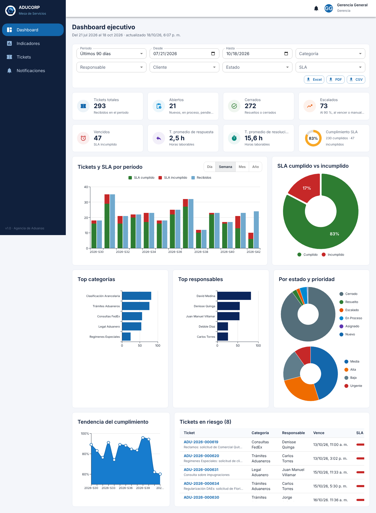

<p align="center"></p>

# Mesa de Servicios ADUCORP

Plataforma web para gestionar las consultas internas de ADUCORP Asesores Aduaneros y Logísticos: tickets con SLA en horas laborables, escalamiento automático, roles y permisos, auditoría, indicadores, exportaciones, notificaciones por correo, asistente de IA e integración con Active Directory.



## Tecnología

| Capa | Tecnología |
|---|---|
| Frontend | React 19, TypeScript, Material UI 9, MUI X Charts, React Query, Vite |
| Backend | Python 3.13, FastAPI, SQLAlchemy 2, Pydantic 2, Gunicorn y Uvicorn |
| Base de datos | SQL Server 2022 (scripts, vistas, procedimientos y triggers en `database/`) |
| Despliegue | Docker Compose, Nginx sin privilegios, GitHub Actions y GHCR |

## Puesta en marcha rápida

```bash
cp .env.example .env        # defina SA_PASSWORD, DB_APP_PASSWORD y JWT_SECRET
docker compose --profile demo up -d --build
```

Abra http://localhost:8080 e ingrese con `admin@aducorp.com.ec` / `Aducorp2026!` (el sistema pide cambiarla). El perfil `demo` carga 650 tickets de ejemplo; omítalo en producción. La API documentada (Swagger) queda en http://localhost:8080/api/v1/docs.

## Estructura

```
backend/      API FastAPI (Clean Architecture), worker de SLA y correos, pruebas
frontend/     SPA React + MUI y configuración de Nginx
database/     Scripts SQL Server 00–06: base, tablas, vistas, procedimientos, triggers, datos iniciales y demo
deploy/       Inicialización de la base, respaldo y restauración
docs/         Arquitectura, modelo de datos, seguridad, manuales, diagramas y capturas
.github/      CI (pruebas, auditoría, stack completo) y publicación de imágenes
```

## Documentación

| Documento | Para quién |
|---|---|
| [Arquitectura](docs/01-arquitectura.md) | Equipo técnico: decisiones, componentes, ciclo del ticket, motor de SLA, RBAC, IA |
| [Modelo de datos](docs/02-modelo-datos.md) | Equipo técnico y DBA: diagrama ER, tablas, vistas y procedimientos |
| [Seguridad](docs/06-seguridad.md) | TI y auditoría: OWASP, sesiones, Active Directory, respuesta a incidentes |
| [Manual técnico](docs/07-manual-tecnico.md) | TI: instalación, configuración, HTTPS, actualización, respaldos, monitoreo, CI/CD |
| [Manual del administrador](docs/08-manual-administrador.md) | Super Admin y Admin Mesa: usuarios, roles, catálogo, SLA, auditoría, configuración |
| [Manual de usuario](docs/09-manual-usuario.md) | Todos: crear y atender tickets, dashboard, reportes, notificaciones |
| [Diagramas](docs/diagramas/) | Arquitectura y modelo ER en SVG |

## Desarrollo

```bash
# Backend (SQLite para desarrollo rápido)
cd backend && pip install -r requirements-dev.txt
python -m app.infrastructure.db.semilla && uvicorn app.main:app --reload
python -m pytest

# Frontend
cd frontend && npm ci && npm run dev    # http://localhost:5173
```

Detalles en [backend/README.md](backend/README.md), [frontend/README.md](frontend/README.md) y en la sección 11 del [manual técnico](docs/07-manual-tecnico.md#11-entorno-de-desarrollo).

## Versiones

Cada etiqueta `vX.Y.Z` publica las imágenes `mesa-api` y `mesa-web` en GitHub Container Registry y crea la versión con sus notas. Ver la sección 10 del [manual técnico](docs/07-manual-tecnico.md#10-integración-y-entrega-continua-github-actions).
