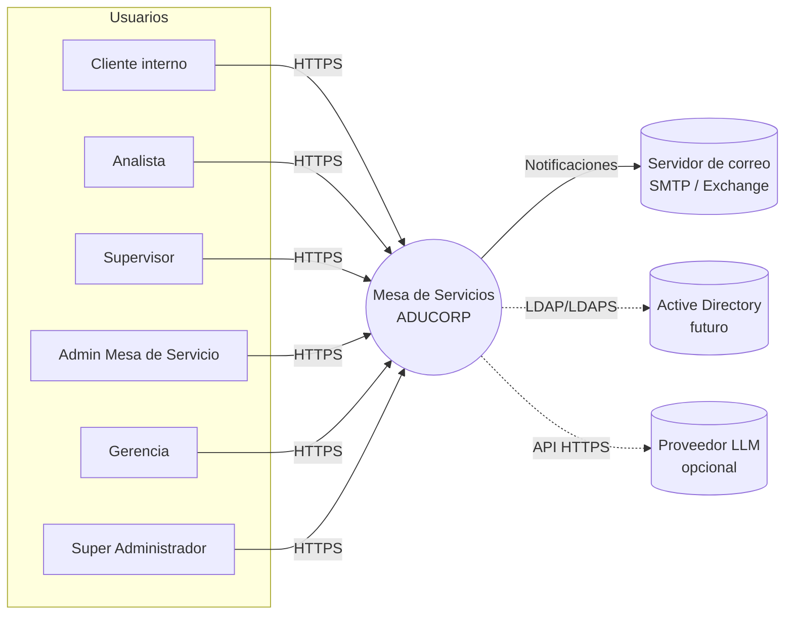
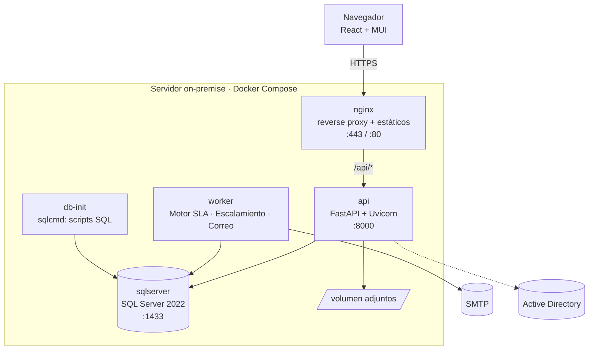
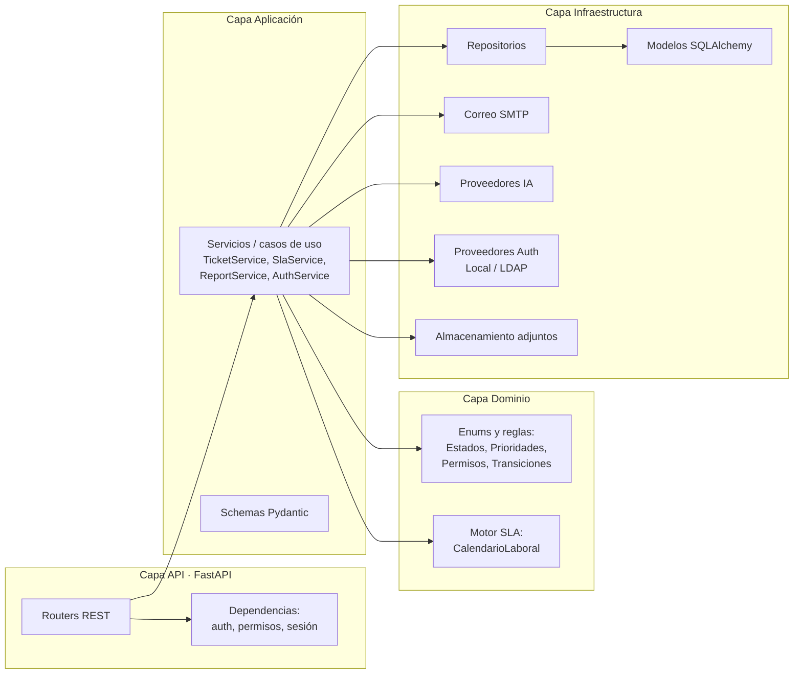
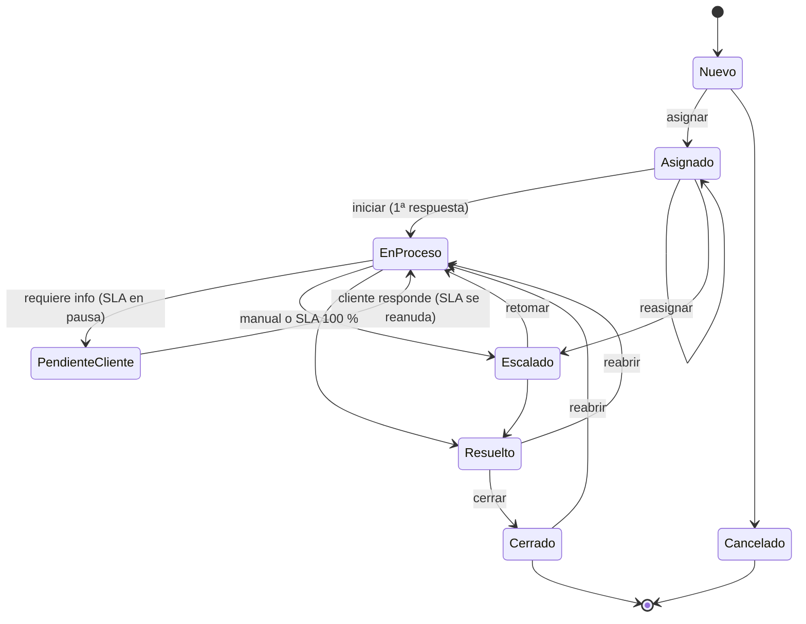

# Fase 1 · Diseño de Arquitectura

**Mesa de Servicios ADUCORP** — Asesores Aduaneros y Logísticos Cía. Ltda.
Versión 1.0 · Octubre 2026

Diagramas exportados en SVG: [contexto](diagramas/contexto.svg), [contenedores](diagramas/arquitectura-contenedores.svg), [capas del backend](diagramas/backend-capas.svg) y [estados del ticket](diagramas/estados-ticket.svg).

---

## 1. Objetivo y alcance

Plataforma web on‑premise para gestionar las solicitudes operativas, legales y aduaneras que llegan a las áreas especializadas de ADUCORP, con control de SLA en horario laboral, escalamiento automático, trazabilidad completa (auditoría) e indicadores gerenciales.

La plataforma sigue las prácticas de **ITIL v4** para la práctica de *Service Request Management* y *Incident Management*:

| Práctica ITIL v4 | Cómo se materializa en la plataforma |
|---|---|
| Service Desk | Punto único de contacto: portal web para clientes internos con catálogo de categorías/subcategorías. |
| Service Request Management | Ticket con categoría, subcategoría, prioridad y responsable sugerido por el catálogo. |
| Service Level Management | Políticas SLA por prioridad (y opcionalmente por categoría), calendario laboral, pausas y registro de incumplimientos. |
| Monitoring & Event Management | Motor de SLA que evalúa cada minuto y dispara alertas al 75 %, 90 % y 100 %. |
| Continual Improvement | Dashboard ejecutivo, indicadores por categoría, responsable y cliente, tendencias históricas. |
| Information Security Management | RBAC, JWT con refresh tokens rotativos, auditoría completa con IP y equipo. |

## 2. Decisiones de arquitectura (ADR resumidos)

| # | Decisión | Alternativa descartada | Motivo |
|---|---|---|---|
| ADR‑01 | **Backend en Python 3.12 + FastAPI + SQLAlchemy 2** | .NET 8 + EF Core | Swagger/OpenAPI nativo, menor tiempo de desarrollo, ecosistema fuerte para IA y para exportaciones (openpyxl, reportlab). Si ADUCORP prefiere .NET, el modelo de datos y los contratos de API se mantienen iguales. |
| ADR‑02 | **SQL Server 2022** como única base de datos | PostgreSQL | Requisito del cliente; licenciamiento y DBA existentes. Driver `pyodbc` + ODBC Driver 18. |
| ADR‑03 | **Clean Architecture en 4 capas** (domain, application, infrastructure, api) | MVC plano | Permite cambiar proveedor de autenticación (Local → Active Directory), de correo o de IA sin tocar reglas de negocio. |
| ADR‑04 | **Repository Pattern + Unit of Work** (sesión SQLAlchemy) | Acceso directo al ORM en los routers | Pruebas unitarias con SQLite en memoria; consultas centralizadas. |
| ADR‑05 | **Motor de SLA en la capa de dominio** (Python puro) | Cálculo en SQL | El cálculo de minutos laborables con feriados, pausas y horarios especiales es lógica de negocio que debe probarse unitariamente. |
| ADR‑06 | **Worker separado** (mismo código, otro proceso) para SLA, escalamientos y correos | Tareas en el proceso web | El API escala horizontalmente sin duplicar alertas; el worker usa un bloqueo en BD para ser único. |
| ADR‑07 | **Cola de correos en BD** (`cola_correos`) | Envío síncrono SMTP | Si el servidor de correo cae, nada se pierde; reintentos con backoff. |
| ADR‑08 | **JWT (15 min) + Refresh Token rotativo (7 días) guardado con hash** | Sesiones en servidor | API sin estado; revocación y detección de reutilización de refresh tokens. |
| ADR‑09 | **IA con proveedor intercambiable**: motor local por reglas/similitud (por defecto, sin salir de la red) y proveedor LLM opcional | Solo LLM en la nube | Los datos aduaneros son sensibles; el modo local funciona on‑premise. El LLM se activa por variable de entorno. |
| ADR‑10 | **React 19 + TypeScript + Vite + Material UI** | Angular | Requisito del cliente; MUI acelera un diseño corporativo consistente. |
| ADR‑11 | **Docker Compose** para on‑premise, con Nginx como reverse proxy | Kubernetes | Escala adecuada para una agencia; un solo servidor Linux o Windows con Docker. |
| ADR‑12 | **Autenticación con proveedor intercambiable** (`AUTH_PROVIDER=local|ldap`) | Solo local | Prepara el soporte futuro de Active Directory sin reescribir el login. |

## 3. Vista de contexto (C4 nivel 1)



## 4. Vista de contenedores (C4 nivel 2) · Diagrama de arquitectura



## 5. Arquitectura del backend (Clean Architecture)



Regla de dependencias: `api → application → domain`; `infrastructure` implementa las interfaces que `application` necesita. El dominio no importa nada de FastAPI ni SQLAlchemy.

### Estructura de carpetas

```
mesa-servicios-aducorp/
├── backend/
│   ├── app/
│   │   ├── core/            # configuración, seguridad JWT, logging
│   │   ├── domain/          # enums, reglas de transición, motor SLA (puro)
│   │   ├── application/     # servicios (casos de uso) y schemas
│   │   ├── infrastructure/  # ORM, repositorios, correo, IA, auth, archivos
│   │   ├── api/             # routers v1 y dependencias
│   │   ├── main.py          # aplicación FastAPI
│   │   └── worker.py        # proceso de SLA/escalamiento/correo
│   ├── tests/
│   └── Dockerfile
├── frontend/                # React + TS + MUI (Vite)
├── database/                # scripts SQL Server numerados + procedimientos
├── docs/                    # arquitectura, modelo de datos, manuales
├── infra/                   # nginx, scripts de despliegue
├── docker-compose.yml
└── .github/workflows/       # CI/CD
```

## 6. Ciclo de vida del ticket (estados)



Reglas clave:

* **Primera respuesta** = primer cambio a *En Proceso* o primer comentario público del responsable. Detiene el reloj de SLA de respuesta.
* **Resolución** = paso a *Resuelto*. Detiene el reloj de SLA de resolución. *Cerrado* es la confirmación (manual o automática a las 72 h laborables, configurable).
* **Pendiente Cliente** pausa ambos relojes; al salir se reanudan automáticamente y los vencimientos se recalculan.
* **Reabrir** desde *Resuelto* o *Cerrado* retoma el SLA de resolución sumando el tiempo ya consumido; se cuenta en `reaperturas`.
* **Incumplido** no es un estado del flujo sino una marca (`sla_incumplido = 1`); el ticket pasa a *Escalado* automáticamente.

## 7. Motor de SLA

| Prioridad | Primera respuesta | Resolución |
|---|---|---|
| Urgente | 1 h | 4 h |
| Alta | 2 h | 8 h |
| Media | 4 h | 24 h |
| Baja | 8 h | 48 h |

* Las horas son **laborables**: se cuentan solo dentro del horario configurado (por defecto lunes a viernes 08:30–13:00 y 14:00–17:30, 8 h diarias, zona `America/Guayaquil`) y se excluyen los feriados nacionales de Ecuador cargados en `calendario_excepciones`.
* **Excepciones de calendario**: feriado (día no laborable) u horario especial (p. ej. 24 de diciembre 08:30–13:00).
* **Excepciones por ticket**: extensión aprobada de minutos o exclusión total del SLA, con motivo y aprobador.
* **Consumo** `% = minutos laborables transcurridos (sin pausas) / minutos SLA de resolución × 100`.
* **Escalamiento** (evaluado cada minuto por el worker, una sola vez por umbral):

| Umbral | Acción |
|---|---|
| 75 % | Correo al responsable + notificación en el sistema |
| 90 % | Correo al supervisor de la categoría + notificación al coordinador (Admin Mesa) |
| 100 % | Marca *Incumplido*, registro en `sla_incumplimientos`, estado *Escalado*, notificación a supervisor y coordinador |

## 8. Seguridad

* **Autenticación**: usuario/contraseña (bcrypt) o Active Directory (LDAP bind) según `AUTH_PROVIDER`. JWT HS256 de 15 min; refresh token opaco de 7 días, guardado como SHA‑256, rotado en cada uso; reutilizar un token revocado revoca toda la familia.
* **Autorización (RBAC)**: permisos atómicos (`ticket.crear`, `sla.modificar`, …) asignados a roles; cada endpoint declara el permiso requerido. Además hay **alcance de datos**: el Analista ve sus tickets, el Supervisor los de las categorías que supervisa, el Cliente interno los propios.
* **Auditoría**: tabla inmutable (`auditoria`) con usuario, fecha y hora, acción, entidad, IP y equipo (user‑agent y nombre de host si se envía). Un trigger en SQL Server impide UPDATE/DELETE.
* **Transporte**: HTTPS en Nginx; cabeceras de seguridad (HSTS, CSP, X‑Frame‑Options); CORS restringido.
* **Adjuntos**: lista blanca de extensiones, tamaño máximo, hash SHA‑256, nombre aleatorio en disco, descarga solo autorizada.
* **Protección de login**: bloqueo temporal tras 5 intentos fallidos.

## 9. Matriz RBAC

| Permiso | Super Admin | Admin Mesa | Supervisor | Analista | Cliente interno | Gerencia |
|---|:-:|:-:|:-:|:-:|:-:|:-:|
| Administrar sistema / configuración | ✔ | | | | | |
| Administrar usuarios y roles | ✔ | | | | | |
| Crear/editar categorías | ✔ | | | | | |
| Modificar SLA / calendario | ✔ | ✔ | | | | |
| Ver todos los tickets | ✔ | ✔ | | | | ✔ (lectura) |
| Ver tickets del área | ✔ | ✔ | ✔ | | | |
| Ver tickets asignados | ✔ | ✔ | ✔ | ✔ | | |
| Ver tickets propios | ✔ | ✔ | ✔ | ✔ | ✔ | |
| Crear ticket | ✔ | ✔ | ✔ | ✔ | ✔ | |
| Editar ticket | ✔ | ✔ | ✔ | ✔ (asignados) | | |
| Asignar / reasignar | ✔ | ✔ | ✔ | | | |
| Escalar | ✔ | ✔ | ✔ | ✔ | | |
| Cambiar estado / registrar actividad | ✔ | ✔ | ✔ | ✔ | | |
| Cerrar ticket | ✔ | ✔ | ✔ | ✔ | | |
| Reabrir ticket | ✔ | ✔ | ✔ | | ✔ (propios) | |
| Adjuntar archivos | ✔ | ✔ | ✔ | ✔ | ✔ | |
| Eliminar registros | ✔ | | | | | |
| Ver reportes / KPIs | ✔ | ✔ | ✔ (área) | | | ✔ |
| Dashboard ejecutivo | ✔ | ✔ | ✔ (área) | | | ✔ |
| Exportar datos | ✔ | ✔ | | | | ✔ |
| Auditoría completa | ✔ | | | | | |

## 10. Catálogo de servicios inicial

| Categoría | Responsable(s) | Subcategorías |
|---|---|---|
| Clasificación Arancelaria | David Medina | 11 |
| Legal Aduanero | Juan Manuel Villamar | 8 |
| Consultas FedEx | Denisse Quinga | 6 |
| Regímenes Especiales | Claudia Vásquez | 5 |
| Trámites Aduaneros | Jorge Caicedo, Debbie Díaz, Carlos Torres (asignación por balanceo de carga) | 16 |

Para *Trámites Aduaneros* el responsable sugerido es el analista con menor número de tickets abiertos (round‑robin ponderado), que el supervisor puede cambiar.

## 11. Inteligencia artificial

| Función | Modo local (por defecto) | Modo LLM (opcional) |
|---|---|---|
| Clasificación automática | Puntuación por palabras clave del catálogo + similitud con tickets históricos | Prompt con el catálogo y el texto |
| Prioridad sugerida | Reglas: términos de urgencia (aforo, multa, plazo, retención), cliente VIP | Igual, razonada |
| Responsable sugerido | Responsable de la categoría con menor carga | Igual |
| Respuesta sugerida | Plantillas por subcategoría | Borrador redactado |
| Riesgo de incumplimiento | Proyección: ritmo de consumo × carga del responsable × estado | Igual |
| Resumen automático | Extractivo (primeras frases + último comentario) | Resumen abstractivo |

Toda sugerencia se guarda en `ia_sugerencias` con su confianza y si el usuario la aceptó, para medir precisión.

## 12. Requisitos no funcionales

| Atributo | Meta |
|---|---|
| Usuarios concurrentes | 200 |
| Tiempo de respuesta API (p95) | < 500 ms |
| Disponibilidad | 99,5 % en horario laboral |
| Respaldo | Full diario + log cada 15 min (SQL Server); adjuntos con rsync diario |
| Retención de auditoría | 5 años |
| Navegadores | Chrome, Edge, Firefox (dos últimas versiones); responsive desde 360 px |

## 13. Plan de fases

| Fase | Entregables |
|---|---|
| 1 · Arquitectura | Este documento, diagramas de contexto, contenedores y capas |
| 2 · Modelo de datos | Diagrama ER, scripts DDL, procedimientos almacenados, datos iniciales y demo |
| 3 · Backend | API FastAPI completa, Swagger, pruebas |
| 4 · Frontend | Portal React + MUI con identidad ADUCORP |
| 5 · Dashboard | Dashboard ejecutivo, indicadores, gráficos y exportaciones |
| 6 · Seguridad | RBAC, auditoría, endurecimiento, preparación AD |
| 7 · Despliegue | Docker Compose, CI/CD GitHub Actions, manuales |
