# Fase 2 · Modelo de Datos

Base de datos **SQL Server 2022**, intercalación `Modern_Spanish_CI_AS`, aislamiento `READ_COMMITTED_SNAPSHOT`.
Todas las fechas se guardan en **UTC** (`DATETIME2`); la aplicación las presenta en hora de Ecuador.

## 1. Scripts

| Orden | Archivo | Contenido |
|---|---|---|
| 0 | `database/00_crear_base.sql` | Base de datos, login y usuario de aplicación con permisos mínimos (lectura, escritura, EXECUTE) |
| 1 | `database/01_tablas.sql` | 33 tablas, claves foráneas, restricciones CHECK e índices |
| 2 | `database/02_vistas.sql` | `vw_tickets_detalle`, `vw_tickets_abiertos_sla`, `vw_carga_responsables` |
| 3 | `database/03_procedimientos.sql` | Procedimientos almacenados y función de filtro |
| 4 | `database/04_triggers.sql` | Auditoría inmutable y bloqueo de borrado físico de tickets |
| 5 | `database/05_datos_iniciales.sql` | Estados, prioridades/SLA, roles, permisos, áreas, horario, feriados, categorías, subcategorías, responsables, usuarios base, plantillas de correo y configuración |
| 6 | `database/06_datos_demo.sql` | 650 tickets demo (abril–octubre 2026), 15 clientes, 10 clientes internos, historial, escalamientos, auditoría |

Todos los scripts son **idempotentes** (se pueden ejecutar varias veces). Se probaron sobre SQL Server 2022 (imagen oficial `mcr.microsoft.com/mssql/server:2022-latest`).

```bash
# Ejecución manual (sqlcmd 18). -I activa QUOTED_IDENTIFIER, necesario para los índices filtrados.
sqlcmd -S servidor -U sa -C -I -v DB_NAME=AducorpMesaServicios APP_LOGIN=aducorp_app APP_PASSWORD="..." -i 00_crear_base.sql
for f in 01_tablas 02_vistas 03_procedimientos 04_triggers 05_datos_iniciales; do
  sqlcmd -S servidor -U sa -C -I -b -d AducorpMesaServicios -i $f.sql
done
# Solo en ambientes de demostración:
sqlcmd -S servidor -U sa -C -I -b -d AducorpMesaServicios -i 06_datos_demo.sql
```

Con Docker Compose esto lo hace automáticamente el contenedor `db-init` (Fase 7).

Los datos demo se regeneran con `python -m scripts.generar_datos_demo` (carpeta `backend/`), que usa el mismo motor de SLA de la API: vencimientos, porcentajes y cumplimiento son coherentes con lo que calcularía el sistema.

## 2. Diagrama Entidad‑Relación

Versión en SVG para imprimir o ampliar: [diagramas/modelo-er.svg](diagramas/modelo-er.svg).

```mermaid
erDiagram
    roles ||--o{ rol_permisos : tiene
    permisos ||--o{ rol_permisos : asignado
    roles ||--o{ usuarios : define
    areas ||--o{ usuarios : pertenece
    usuarios ||--o{ usuarios : supervisa
    usuarios ||--o{ refresh_tokens : sesiones

    categorias ||--o{ subcategorias : contiene
    categorias ||--o{ categoria_responsables : atendida_por
    usuarios ||--o{ categoria_responsables : responsable
    usuarios ||--o{ categorias : supervisor
    categorias ||--o{ sla_politicas : sobrescribe
    prioridades ||--o{ sla_politicas : para

    horarios_laborales ||--o{ horario_tramos : tramos
    horarios_laborales ||--o{ calendario_excepciones : excepciones

    estados ||--o{ tickets : estado
    prioridades ||--o{ tickets : prioridad
    categorias ||--o{ tickets : categoria
    subcategorias ||--o{ tickets : subcategoria
    clientes ||--o{ tickets : cliente
    areas ||--o{ tickets : area
    usuarios ||--o{ tickets : solicita
    usuarios ||--o{ tickets : responde

    tickets ||--o{ ticket_comentarios : comentarios
    tickets ||--o{ ticket_adjuntos : adjuntos
    ticket_comentarios ||--o{ ticket_adjuntos : adjunta
    tickets ||--o{ ticket_historial : historial
    tickets ||--o{ ticket_asignaciones : asignaciones
    tickets ||--o{ ticket_escalamientos : escalamientos
    tickets ||--o{ sla_pausas : pausas
    tickets ||--o{ sla_excepciones : excepciones
    tickets ||--o{ sla_incumplimientos : incumplimientos
    tickets ||--o{ notificaciones : genera
    tickets ||--o{ cola_correos : genera
    tickets ||--o{ ia_sugerencias : sugerencias
    usuarios ||--o{ notificaciones : recibe

    tickets {
        bigint id PK
        varchar numero UK "ADU-2026-000123"
        nvarchar asunto
        nvarchar descripcion
        int solicitante_id FK
        nvarchar solicitante_nombre
        nvarchar solicitante_cargo
        int area_id FK
        int cliente_id FK
        nvarchar correo
        nvarchar telefono
        int categoria_id FK
        int subcategoria_id FK
        int prioridad_id FK
        int responsable_id FK
        varchar estado FK
        datetime2 fecha_creacion
        datetime2 fecha_primera_respuesta
        datetime2 fecha_resolucion
        datetime2 fecha_cierre
        int sla_respuesta_min
        int sla_resolucion_min
        datetime2 sla_respuesta_vence
        datetime2 sla_resolucion_vence
        int sla_minutos_pausa
        decimal sla_consumido_pct
        bit sla_respuesta_cumplido
        bit sla_resolucion_cumplido
        bit sla_incumplido
        tinyint sla_nivel_alerta "0/75/90/100"
        varchar cumplimiento_sla "calculada"
        int version "concurrencia"
    }
    usuarios {
        int id PK
        nvarchar nombre
        nvarchar correo UK
        nvarchar usuario_ad UK "soporte AD"
        varchar origen_autenticacion "LOCAL/AD"
        varchar clave_hash "bcrypt"
        int rol_id FK
        int area_id FK
        int supervisor_id FK
        bit activo
    }
    categorias {
        int id PK
        varchar codigo UK
        nvarchar nombre
        nvarchar palabras_clave "IA local"
        int supervisor_id FK
        varchar modo_asignacion "PRINCIPAL/BALANCEO/MANUAL"
    }
    prioridades {
        int id PK
        varchar codigo UK
        int sla_respuesta_min
        int sla_resolucion_min
    }
    auditoria {
        bigint id PK
        int usuario_id
        datetime2 fecha_hora
        varchar accion
        varchar entidad
        varchar entidad_id
        nvarchar detalle "JSON"
        varchar ip
        nvarchar equipo
    }
```



## 3. Diccionario de datos (resumen)

### Seguridad

| Tabla | Propósito | Notas |
|---|---|---|
| `roles` | 6 roles del sistema | `SUPER_ADMIN`, `ADMIN_MESA`, `SUPERVISOR`, `ANALISTA`, `CLIENTE`, `GERENCIA` |
| `permisos` | 24 permisos atómicos | p. ej. `ticket.asignar`, `sla.modificar`, `datos.exportar` |
| `rol_permisos` | Matriz RBAC | Editable por el Super Administrador |
| `usuarios` | Cuentas | `origen_autenticacion = AD` + `usuario_ad` preparan la integración con Active Directory; `intentos_fallidos` y `bloqueado_hasta` protegen el login |
| `refresh_tokens` | Sesiones | Solo se guarda el hash SHA‑256; `familia` permite revocar toda la cadena si se detecta reutilización |
| `areas` | Departamento del solicitante | |

### Catálogo

| Tabla | Propósito |
|---|---|
| `categorias` | 5 categorías; supervisor, modo de asignación y palabras clave para la IA |
| `subcategorias` | 46 subcategorías; palabras clave y plantilla de respuesta sugerida |
| `categoria_responsables` | Responsable(s) por categoría; `es_principal` para asignación directa; *Trámites Aduaneros* usa balanceo entre 3 analistas |
| `clientes` | Empresas importadoras/exportadoras atendidas (RUC, VIP) |

### SLA

| Tabla | Propósito |
|---|---|
| `prioridades` | SLA base por prioridad (minutos laborables) |
| `sla_politicas` | Sobrescritura opcional por categoría + prioridad |
| `horarios_laborales`, `horario_tramos` | Horario semanal por tramos (por defecto L‑V 08:30‑13:00 y 14:00‑17:30) |
| `calendario_excepciones` | Feriados y jornadas especiales |
| `sla_pausas` | Intervalos con el reloj detenido (Pendiente Cliente, Resuelto) |
| `sla_excepciones` | Extensión de minutos o exclusión del SLA para un ticket, con aprobador |
| `sla_incumplimientos` | Registro de cada incumplimiento de respuesta o resolución |

### Tickets

| Tabla | Propósito |
|---|---|
| `estados` | 8 estados; `pausa_sla` y `es_final` gobiernan el motor |
| `ticket_secuencias` | Correlativo anual para el número `ADU-AAAA-NNNNNN` |
| `tickets` | Registro principal con todos los campos solicitados y los cálculos de SLA |
| `ticket_comentarios` | Comentarios públicos, notas internas y actividades (con minutos invertidos) |
| `ticket_adjuntos` | Metadatos de archivos; el archivo vive en el volumen de adjuntos |
| `ticket_historial` | Cada cambio de campo (valor anterior → nuevo) |
| `ticket_asignaciones` | Asignaciones y reasignaciones con motivo |
| `ticket_escalamientos` | Escalamientos automáticos (75/90/100 %) y manuales |

### Notificaciones, auditoría, IA y sistema

| Tabla | Propósito |
|---|---|
| `notificaciones` | Centro de notificaciones del usuario |
| `plantillas_correo` | 7 plantillas HTML con variables `{numero}`, `{asunto}`, … |
| `cola_correos` | Cola con reintentos; la procesa el worker |
| `auditoria` | Registro inmutable (trigger) con usuario, fecha y hora, acción, IP y equipo |
| `ia_sugerencias` | Sugerencias emitidas y si fueron aceptadas |
| `configuracion` | Parámetros clave/valor |
| `bloqueos_proceso` | Garantiza un solo worker activo |

## 4. Procedimientos almacenados

| Procedimiento | Uso |
|---|---|
| `sp_GenerarNumeroTicket` | Correlativo anual concurrente (UPDLOCK/HOLDLOCK) |
| `fn_TicketsFiltrados` | Función en línea con los filtros comunes (fecha, categoría, responsable, cliente, estado) |
| `sp_DashboardEjecutivo` | Los 8 widgets del dashboard ejecutivo |
| `sp_IndicadoresCategoria` | Recibidos, resueltos, pendientes, vencidos, cumplimiento, tiempos y backlog por categoría |
| `sp_IndicadoresResponsable` | Asignados, cerrados, SLA cumplido/incumplido, productividad y ranking |
| `sp_IndicadoresCliente` | Tickets por cliente, categorías más usadas, cumplimiento y tendencia |
| `sp_TendenciaTickets` | Serie por día, semana ISO, mes o año |
| `sp_TicketsPorVencer` | Tickets abiertos con SLA consumido ≥ umbral |
| `sp_RegistrarAuditoria` / `sp_ConsultarAuditoria` | Auditoría desde integraciones / consulta paginada |
| `sp_Mantenimiento` | Depuración de tokens vencidos, notificaciones leídas antiguas y correos enviados (programar en SQL Agent) |

### Definición de indicadores

* **Abiertos**: Nuevo, Asignado, En Proceso, Pendiente Cliente o Escalado.
* **Cerrados**: Resuelto o Cerrado.
* **Escalados**: escalamiento manual o automático desde el 90 % (el aviso del 75 % no cuenta como escalamiento).
* **Vencidos**: `sla_incumplido = 1`.
* **Cumplimiento SLA %**: cumplidos ÷ (cumplidos + incumplidos), sin tickets excluidos ni aún en curso.
* **Tiempos promedio**: horas laborables, sin pausas.
* **Productividad**: tickets cerrados por día laborable del período.
* **Ranking**: 60 % cumplimiento SLA + 40 % volumen cerrado relativo al mejor analista.

## 5. Usuarios base

Contraseña inicial: `Aducorp2026!` (se exige cambiarla en el primer ingreso; los clientes internos demo no la cambian).

| Usuario | Rol |
|---|---|
| admin@aducorp.com.ec | Super Administrador |
| mesa.servicios@aducorp.com.ec | Administrador Mesa de Servicio |
| gerencia@aducorp.com.ec | Gerencia |
| supervisor.tecnico@aducorp.com.ec | Supervisor (Clasificación, Legal, Regímenes) |
| supervisor.operativo@aducorp.com.ec | Supervisor (FedEx, Trámites) |
| david.medina@, juan.villamar@, denisse.quinga@, claudia.vasquez@, jorge.caicedo@, debbie.diaz@, carlos.torres@ | Analistas |
| maria.andrade@ y 9 más (solo datos demo) | Clientes internos |

> Los supervisores son cuentas genéricas porque el requerimiento no nombra supervisores; se reemplazan desde Administración → Usuarios.
