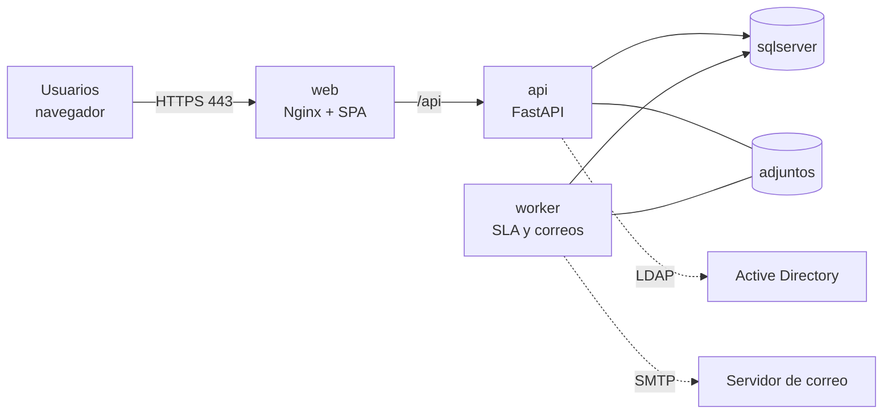

# Fase 7 · Manual técnico: despliegue y operación

Este manual está dirigido al equipo de TI de ADUCORP. Explica cómo instalar, configurar, actualizar, respaldar y vigilar la Mesa de Servicios. La arquitectura, el modelo de datos y la seguridad se describen en [01-arquitectura.md](01-arquitectura.md), [02-modelo-datos.md](02-modelo-datos.md) y [06-seguridad.md](06-seguridad.md).

## 1. Componentes desplegados

| Servicio (Compose) | Imagen | Función | Puerto |
|---|---|---|---|
| `sqlserver` | `mcr.microsoft.com/mssql/server:2022-latest` | Base de datos `AducorpMesaServicios` | 1433, solo red interna |
| `db-init` | la misma imagen | Crea o actualiza la base (scripts 00 a 05) y termina | — |
| `db-demo` | la misma imagen | Perfil `demo`: carga los 650 tickets de ejemplo (06) | — |
| `api` | `mesa-api` (backend/) | API REST FastAPI con Gunicorn y 4 workers Uvicorn | 8000, solo red interna |
| `worker` | `mesa-api` | Motor de SLA, escalamientos, cierre automático, correos | — |
| `web` | `mesa-web` (frontend/) | Nginx sin privilegios: SPA de React y proxy `/api` | 8080 (HTTP) / 8443 (HTTPS) |

Volúmenes: `sqldata` (archivos de SQL Server) y `adjuntos` (archivos adjuntos de los tickets). La carpeta `./backups` del servidor se monta en SQL Server para los respaldos.



## 2. Requisitos del servidor

* Linux x86_64 (Ubuntu Server 24.04 LTS o RHEL 9 recomendados) con Docker Engine 27 o superior y el plugin Docker Compose v2.27 o superior.
* Mínimo 4 vCPU, 8 GB de RAM (SQL Server reserva 2 GB) y 60 GB de disco; con 50 usuarios simultáneos, 4 vCPU y 12 GB.
* Salida a internet solo para descargar imágenes (o un registro interno con las imágenes copiadas).
* Acceso de red al controlador de dominio (LDAP 389 o LDAPS 636) y al servidor SMTP, si se usan.
* Un nombre DNS interno, por ejemplo `mesa.aducorp.com.ec`, y su certificado TLS.

## 3. Instalación

```bash
# 1. Copiar el proyecto al servidor
sudo mkdir -p /opt/aducorp-mesa && cd /opt/aducorp-mesa
git clone <repositorio> .            # o descomprimir el paquete entregado

# 2. Configurar
chmod +x deploy/*.sh
cp .env.example .env
chmod 600 .env
nano .env                             # ver la sección 4

# 3. Construir y levantar (la primera vez tarda unos minutos)
docker compose up -d --build

# 4. Comprobar
docker compose ps
curl http://localhost:8080/api/v1/health
# {"estado":"ok","base_datos":"ok","version":"1.0.0"}
```

`db-init` espera a que SQL Server esté sano, aplica los scripts y termina; la API arranca solo cuando ha terminado bien. Los scripts son idempotentes: se ejecutan en cada `up` sin borrar datos.

**Datos de demostración** (solo para capacitación o pruebas, nunca en producción):

```bash
docker compose --profile demo up -d
```

**Primer ingreso:** `admin@aducorp.com.ec` con la contraseña inicial `Aducorp2026!`. El sistema obliga a cambiarla. Haga lo mismo con las cuentas sembradas que vaya a usar, o desactívelas desde *Administración › Usuarios*.

## 4. Variables de configuración (.env)

Las variables obligatorias están marcadas con ★. Compose se niega a arrancar si falta alguna.

| Variable | Ejemplo | Descripción |
|---|---|---|
| `VERSION`, `REGISTRO` | `1.0.0`, `ghcr.io/aducorp` | Etiqueta y registro de las imágenes |
| `WEB_PUERTO` | `8080` | Puerto publicado en HTTP |
| ★ `SA_PASSWORD` | — | Contraseña del usuario `sa` (8+ caracteres con mayúsculas, minúsculas, números y símbolos) |
| `MSSQL_PID` | `Developer` | Edición: `Standard` o `Enterprise` con licencia en producción |
| `DB_NAME`, `DB_APP_USER` | `AducorpMesaServicios`, `mesa_app` | Base y login de la aplicación (sin privilegios de administrador) |
| ★ `DB_APP_PASSWORD` | — | Contraseña del login de la aplicación. Evite `@`, `/`, `?` y `#`, porque va dentro de una URL |
| `APP_ENV` | `production` | En producción se validan el secreto JWT y la base de datos |
| `APP_URL` | `https://mesa.aducorp.com.ec` | URL pública que aparece en los enlaces de los correos |
| `CORS_ORIGINS` | `["https://mesa.aducorp.com.ec"]` | Orígenes permitidos (lista JSON) |
| ★ `JWT_SECRET` | — | 32 caracteres o más: `openssl rand -hex 32` |
| `DOCS_ENABLED` | `true` | Publica Swagger en `/api/v1/docs` (`false` para ocultarlo) |
| `AUTH_PROVIDER` | `local` o `ldap` | Inicio de sesión local o con Active Directory |
| `LDAP_*` | ver [06-seguridad.md §4](06-seguridad.md#4-integración-con-active-directory) | Servidor, dominio, base DN, cuenta de servicio y mapeo de grupos a roles |
| `EMAIL_ENABLED`, `SMTP_*` | `true`, `smtp.office365.com`, `587` | Envío de correos de asignación, avisos de SLA y cierre |
| `AI_PROVIDER` | `local` o `llm` | Motor de IA: local (sin enviar datos fuera) o Claude (`llm`) |
| `ANTHROPIC_API_KEY` | — | Solo si `AI_PROVIDER=llm` |
| `WORKER_INTERVALO_SEG` | `60` | Frecuencia del motor de SLA |
| `LOG_LEVEL` | `INFO` | `DEBUG` solo para diagnóstico |

Después de cambiar el `.env`, aplique los cambios con `docker compose up -d`. Compose recrea solo los servicios afectados.

## 5. HTTPS

1. Copie el certificado (con la cadena intermedia) y la clave privada a `./certs/mesa.crt` y `./certs/mesa.key`, con permisos 640.
2. Levante con el archivo adicional:

```bash
docker compose -f docker-compose.yml -f docker-compose.https.yml up -d
```

Nginx publica los puertos 80 y 443, redirige HTTP a HTTPS y activa TLS 1.2/1.3 con HSTS. Para no repetir los `-f`, agregue al `.env`:

```
COMPOSE_FILE=docker-compose.yml:docker-compose.https.yml
```

Si ya existe un balanceador o proxy inverso corporativo que termina TLS, use solo `docker-compose.yml` y apunte el proxy al puerto 8080. Si ese proxy no está en una red privada (10/8, 172.16/12 o 192.168/16), añada su IP a `TRUSTED_PROXIES` para que la auditoría registre la IP real del usuario.

## 6. Active Directory y correo

* **Active Directory:** siga la guía paso a paso de [06-seguridad.md §4](06-seguridad.md#4-integración-con-active-directory). Con `AUTH_PROVIDER=ldap`, los usuarios entran con su cuenta del dominio. La cuenta `admin@aducorp.com.ec` sigue siendo local para no perder el acceso si el dominio falla.
* **Correo:** con Microsoft 365 use `SMTP_HOST=smtp.office365.com`, `SMTP_PORT=587`, `SMTP_STARTTLS=true` y un buzón con SMTP AUTH habilitado. El worker envía los correos desde una cola. Si el servidor SMTP falla, reintenta a los 1, 2, 4, 8 y 16 minutos y, tras 6 intentos, lo marca como descartado. La notificación dentro del sistema no se pierde.
* **Microsoft 365 (Entra ID, buzón soporte@ y Teams):** la configuración completa está en [10-microsoft-365.md](10-microsoft-365.md). Con `AUTH_PROVIDER=entra` el login es con la cuenta de Microsoft (MFA lo exige Acceso condicional) y con `EMAIL_TRANSPORTE=graph` los correos salen por Microsoft Graph, sin SMTP AUTH.

## 7. Actualización de versiones

**Desde el código fuente:**

```bash
cd /opt/aducorp-mesa
./deploy/respaldo.sh completo          # siempre respalde antes
git pull
docker compose up -d --build
```

**Desde imágenes publicadas en GitHub (recomendado):** cada etiqueta `vX.Y.Z` publica `mesa-api` y `mesa-web` en GHCR (ver la sección 10).

```bash
# .env: REGISTRO=ghcr.io/<propietario>   VERSION=1.1.0
docker login ghcr.io                   # token con permiso read:packages si el repositorio es privado
docker compose pull api web
docker compose up -d
```

`db-init` vuelve a ejecutarse y aplica los cambios de esquema de la nueva versión. Para volver atrás, restaure el respaldo previo (sección 8) y fije la `VERSION` anterior.

## 8. Respaldos y restauración

`deploy/respaldo.sh` genera respaldos comprimidos y con *checksum* en `./backups`:

| Comando | Qué respalda | Programación sugerida (cron) |
|---|---|---|
| `./deploy/respaldo.sh completo` | Base completa (`.bak`) y adjuntos (`.tar.gz`); borra los de más de 30 días | Diario, `0 23 * * *` |
| `./deploy/respaldo.sh log` | Log de transacciones (`.trn`), para recuperar hasta 15 minutos antes de un fallo | `*/15 7-19 * * 1-5` |

```bash
sudo crontab -e
0 23 * * *         cd /opt/aducorp-mesa && ./deploy/respaldo.sh completo >> /var/log/mesa-respaldo.log 2>&1
*/15 7-19 * * 1-5  cd /opt/aducorp-mesa && ./deploy/respaldo.sh log      >> /var/log/mesa-respaldo.log 2>&1
```

Copie `./backups` a otro equipo o almacenamiento (NAS, OneDrive, cinta) al menos una vez al día. Un respaldo en el mismo servidor no protege contra la pérdida del servidor.

**Restaurar** (detiene la aplicación, reemplaza la base y vuelve a levantarla):

```bash
./deploy/restaurar.sh backups/AducorpMesaServicios_20261018_2300.bak backups/adjuntos_20261018_2300.tar.gz
```

Pruebe la restauración una vez al trimestre en un equipo de pruebas.

## 9. Monitoreo y registros

| Qué revisar | Cómo |
|---|---|
| Estado general | `docker compose ps`: todos `Up` y `healthy` (salvo `db-init`, que termina con `Exited (0)`) |
| Salud de la API y la base | `GET /api/v1/health` responde 200 con `"base_datos":"ok"`; úselo en Zabbix, PRTG o Uptime Kuma |
| Registros | `docker compose logs -f api worker web`: la API registra cada petición con método, ruta, código, duración e identificador |
| Motor de SLA | El worker escribe una línea por ciclo (`Ciclo sla`, `Ciclo cierre`, `Ciclo correo`) con sus resultados |
| Accesos y cambios | *Administración › Auditoría* en la aplicación |
| Espacio en disco | `docker system df` y el tamaño de `./backups` |

Docker rota los registros si se configura en `/etc/docker/daemon.json`:

```json
{ "log-driver": "json-file", "log-opts": { "max-size": "20m", "max-file": "5" } }
```

## 10. Integración y entrega continua (GitHub Actions)

| Flujo | Cuándo | Qué hace |
|---|---|---|
| `.github/workflows/ci.yml` | Cada push a `main` y cada pull request | Pruebas del backend (pytest) y auditoría de dependencias (pip-audit); compilación TypeScript, build y `npm audit` del frontend; construye las imágenes, levanta el stack completo con SQL Server y datos de demostración, y ejecuta una prueba de humo (login, tickets, dashboard, exportación, cabecera CSP y redespliegue de la base) |
| `.github/workflows/publicar.yml` | Al publicar una etiqueta `vX.Y.Z` | Construye y publica `mesa-api` y `mesa-web` en `ghcr.io/<propietario>` con las etiquetas `X.Y.Z`, `X.Y`, `latest` y el SHA, y crea la versión en GitHub con notas automáticas |
| `.github/dependabot.yml` | Semanal | Propone actualizaciones de pip, npm, imágenes base y acciones |

Para publicar una versión:

```bash
git tag v1.0.0
git push origin v1.0.0
```

Se recomienda proteger la rama `main` y exigir que el flujo CI pase antes de fusionar.

## 11. Entorno de desarrollo

```bash
# Base de datos y correo de pruebas (Mailpit en http://localhost:8025)
docker compose -f docker-compose.yml -f docker-compose.dev.yml up -d sqlserver db-init mailpit

# Backend
cd backend && python -m venv .venv && . .venv/bin/activate
pip install -r requirements-dev.txt
cp .env.example .env                  # DATABASE_URL apuntando a localhost:1433
uvicorn app.main:app --reload         # http://localhost:8000/api/v1/docs
python -m pytest                      # 43 pruebas en SQLite en memoria

# Frontend
cd frontend && npm ci && npm run dev  # http://localhost:5173 (proxy /api a :8000)
```

Sin SQL Server, el backend también funciona con SQLite (`DATABASE_URL=sqlite:///./aducorp_dev.db`): `python -m app.infrastructure.db.semilla` crea las tablas y los datos base. Los datos de demostración de SQL Server se regeneran con `python -m scripts.generar_datos_demo`, que escribe `database/06_datos_demo.sql`.

## 12. API y Swagger

* Swagger UI: `https://<servidor>/api/v1/docs`. ReDoc: `/api/v1/redoc`. Esquema OpenAPI: `/api/v1/openapi.json`.
* Para probar desde Swagger: ejecute `POST /api/v1/auth/login`, copie el `access_token` y péguelo en **Authorize**.
* Todos los endpoints están en `/api/v1` y agrupados por módulo: `auth`, `tickets`, `catalogos`, `notificaciones`, `reportes`, `auditoria` y `admin`.
* Con `DOCS_ENABLED=false` se ocultan Swagger y el esquema, por ejemplo si la mesa se publica fuera de la red interna.

## 13. Solución de problemas

| Síntoma | Causa probable | Solución |
|---|---|---|
| `db-init` termina con error de *login failed* | `SA_PASSWORD` cambiada después de crear el volumen | SQL Server conserva la contraseña con la que se creó: use la original o cámbiela con `sqlcmd` (`ALTER LOGIN sa WITH PASSWORD=...`) |
| SQL Server se reinicia en bucle | Contraseña `sa` sin la complejidad exigida, o menos de 2 GB de RAM | Revise `docker compose logs sqlserver` |
| La API no arranca: *JWT_SECRET* | En producción, el secreto es corto o es el del ejemplo | Genere uno con `openssl rand -hex 32` |
| La web muestra *502 Bad Gateway* | La API todavía arranca o se cayó | `docker compose logs api`; espere a que el estado sea `healthy` |
| *Demasiados intentos* (HTTP 429) al iniciar sesión | Límite de 10 intentos por minuto por IP | Espere un minuto. Si todos los usuarios comparten una IP (NAT), revise `TRUSTED_PROXIES` |
| Cuenta bloqueada | 5 intentos fallidos | Se desbloquea sola a los 15 minutos; para desbloquearla antes, genere una contraseña temporal en *Administración › Usuarios* |
| No llegan correos | `EMAIL_ENABLED=false`, credenciales o SMTP AUTH deshabilitado | `docker compose logs worker`; pruebe con Mailpit en desarrollo |
| Los SLA no avanzan o no hay avisos | Worker detenido | `docker compose ps worker`; `docker compose restart worker` |
| Error al subir un archivo | Extensión no permitida, tamaño mayor al máximo o contenido que no coincide con la extensión | Ajuste `adjuntos.*` en *Administración › Configuración*; los rechazos quedan en la auditoría |
