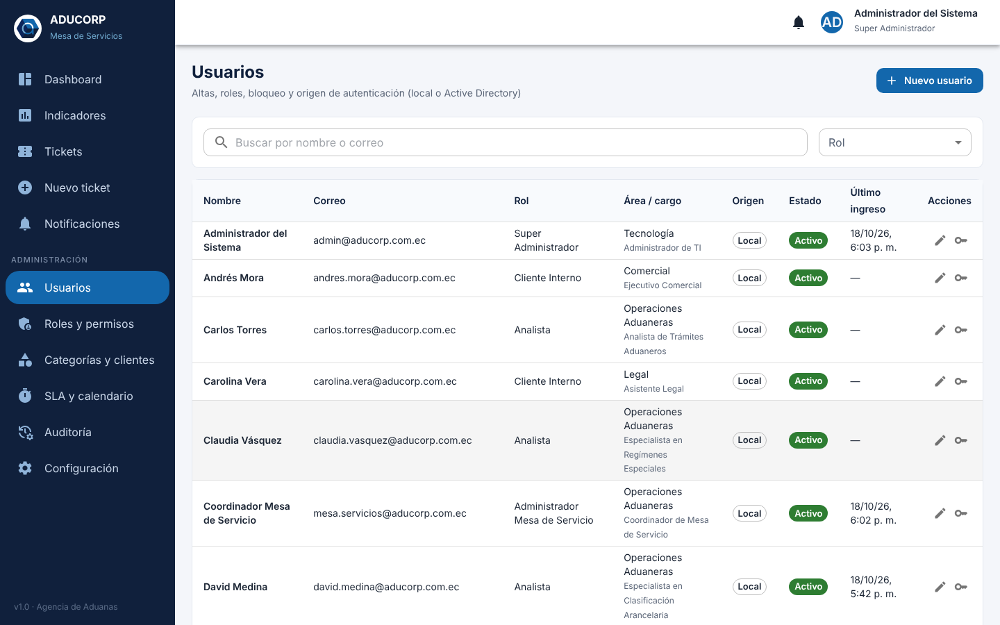
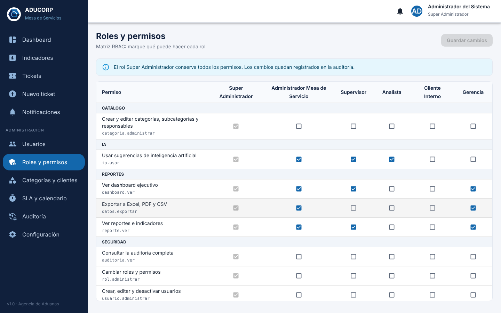
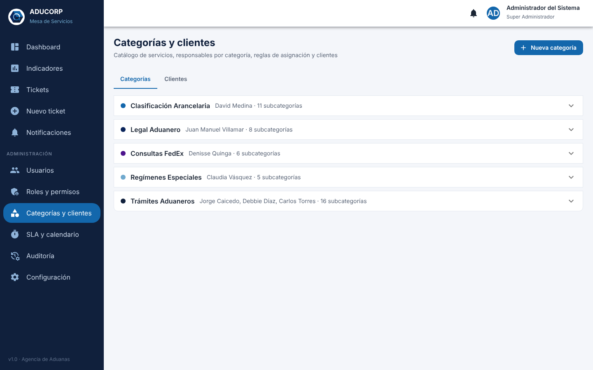
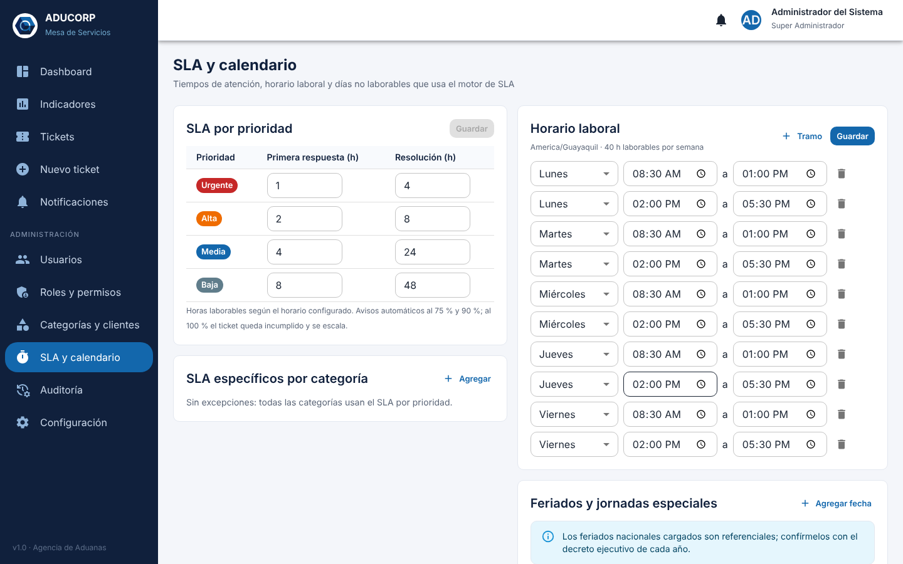
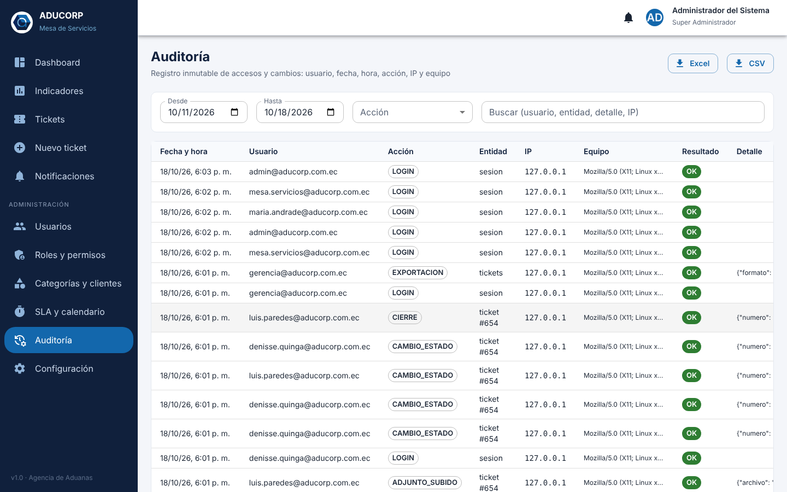

# Manual del administrador

Este manual es para quienes administran la Mesa de Servicios desde la propia aplicación: el **Super Administrador** (TI) y el **Administrador de Mesa** (coordinación). Todo lo que se describe está en el menú **Administración**. Cada opción aparece solo si el rol tiene el permiso correspondiente. La instalación y las tareas del servidor están en el [manual técnico](07-manual-tecnico.md).

| Pantalla | Super Admin | Admin Mesa |
|---|:-:|:-:|
| Usuarios | ✔ | |
| Roles y permisos | ✔ | |
| Categorías y clientes | ✔ | |
| SLA y calendario | ✔ | ✔ |
| Auditoría | ✔ | |
| Configuración | ✔ | |

## 1. Primeros pasos después de la instalación

1. Ingrese con `admin@aducorp.com.ec` y la contraseña inicial `Aducorp2026!`. El sistema le pedirá cambiarla.
2. Revise **Configuración**: nombre de la empresa, umbrales de aviso y límites de adjuntos (sección 7).
3. Revise **SLA y calendario**: horario laboral y feriados del año (sección 5).
4. Cree o active a los usuarios reales y asígneles su rol (sección 2). Si se usa Active Directory, los usuarios se crean solos en su primer ingreso.
5. Revise **Categorías y clientes**: responsables de cada categoría, supervisor y clientes VIP (sección 4).

## 2. Usuarios

La lista muestra el nombre, el correo, el rol, el área y el cargo, el origen (local o Active Directory), el estado (Activo, Bloqueado o Inactivo) y el último ingreso. Puede filtrar por rol y buscar por nombre o correo.

Cuando el login es con Microsoft 365, los usuarios aparecen con origen **Microsoft 365** y su rol lo decide el grupo de Entra ID al que pertenecen: cámbielo en Entra ID, no aquí. Vea [10-microsoft-365.md](10-microsoft-365.md).

**Crear un usuario:** botón **Nuevo usuario**.

* **Autenticación local:** si deja vacía la *contraseña inicial*, el sistema genera una contraseña temporal y la muestra una sola vez con el botón **Copiar**. Entréguela al usuario por un canal seguro; en su primer ingreso deberá cambiarla.
* **Active Directory:** indique el *usuario de dominio* (por ejemplo `dmedina`). No se guarda ninguna contraseña, porque se valida contra el dominio.
* **Supervisor directo y área:** se usan en los reportes y en los avisos de escalamiento.

**Acciones habituales:**

| Necesidad | Cómo |
|---|---|
| Cambiar el rol o los datos | Botón **Editar** (lápiz). Nadie puede cambiar su propio rol |
| Olvidó la contraseña o la cuenta está bloqueada | **Generar contraseña temporal** (llave): desbloquea la cuenta y obliga a cambiar la clave |
| Alguien deja la empresa | **Editar** › desmarque **Activo**. Su historial y auditoría se conservan; no se recomienda eliminar usuarios |
| Cortar una sesión abierta de inmediato | Desactive al usuario: el sistema lo comprueba en cada petición y el acceso se corta al instante |

La cuenta se bloquea 15 minutos tras 5 intentos fallidos (ambos valores se configuran en la sección 7).

## 3. Roles y permisos (matriz RBAC)

Hay 6 roles: Super Administrador, Administrador de Mesa, Supervisor, Analista, Cliente interno y Gerencia. La matriz muestra cada permiso en una fila y cada rol en una columna; marque o desmarque y guarde.

* Los permisos del **Super Administrador** no se pueden reducir, para que nunca se pierda el acceso de administración.
* Además del permiso, el sistema aplica un **alcance de datos** que no depende de la matriz: el Analista ve los tickets que tiene asignados, el Supervisor los de las categorías que supervisa y el Cliente interno los que él mismo creó.
* Todo cambio queda en la auditoría con la lista de permisos antes y después.

La matriz inicial está en [01-arquitectura.md §9](01-arquitectura.md#9-matriz-rbac).

## 4. Categorías, subcategorías y clientes

**Categorías.** Cada categoría tiene:

* **Código, nombre, descripción, color y orden.** El color y el orden se usan en las listas y los gráficos.
* **Supervisor:** recibe el aviso del 90 % del SLA y ve todos los tickets de la categoría.
* **Responsables:** analistas que atienden la categoría. Uno se marca como principal.
* **Modo de asignación:**

| Modo | Comportamiento al crear un ticket |
|---|---|
| Responsable principal | Se asigna al responsable principal |
| Balanceo por carga | Se asigna al responsable con menos tickets abiertos (por ejemplo, Trámites Aduaneros) |
| Manual (la mesa asigna) | Queda en *Nuevo* hasta que la mesa o el supervisor lo asigne |

* **Palabras clave (IA):** términos separados por comas que ayudan a clasificar automáticamente los tickets nuevos.

**Subcategorías.** Cada subcategoría tiene sus propias **palabras clave** y una **plantilla de respuesta sugerida**, que la IA propone al analista como primer borrador.

**Clientes.** Cada cliente tiene RUC, razón social, correo, teléfono y la marca **VIP**. Los tickets de clientes VIP reciben una prioridad sugerida más alta.

**Copia automática (opcional).** En la categoría y en el cliente puede indicar hasta 10 correos. Cada ticket nuevo de esa categoría o de ese cliente los agrega a sus **Personas en copia**, que reciben por correo las respuestas al solicitante y el cierre. En cada ticket se pueden quitar o agregar correos.

Una categoría o subcategoría con tickets no se elimina: se marca **Inactiva**, deja de ofrecerse en los tickets nuevos y su historial se conserva.

## 5. SLA y calendario

**SLA por prioridad.** Define las horas laborables de primera respuesta y de resolución:

| Prioridad | Primera respuesta | Resolución |
|---|---|---|
| Urgente | 1 h | 4 h |
| Alta | 2 h | 8 h |
| Media | 4 h | 24 h |
| Baja | 8 h | 48 h |

**SLA por categoría.** Reemplaza el anterior para una combinación de categoría y prioridad. Por ejemplo, Legal Aduanero con prioridad Alta y 16 h de resolución.

**Horario laboral.** Tramos por día de la semana (por defecto, lunes a viernes de 08:30 a 13:00 y de 14:00 a 17:30). Solo se cuentan esas horas.

**Feriados y jornadas especiales.**

* *Feriado (no laborable):* el día no cuenta para el SLA.
* *Jornada especial (horario reducido):* el día cuenta solo en el horario indicado, por ejemplo el 24 de diciembre de 08:30 a 13:00.

Cargue al inicio de cada año los feriados nacionales que decrete el Gobierno, incluidos los traslados. La lista inicial es de referencia.

Los cambios de SLA se aplican a los **tickets nuevos**. Los tickets abiertos conservan los plazos con los que se crearon, salvo que se registre una excepción.

**Excepciones por ticket.** Desde el detalle de un ticket abierto, en *Más acciones › Excepción de SLA*, quien tenga el permiso de modificar SLA (Super Admin y Admin Mesa) puede:

* conceder una **extensión** de minutos laborables, por ejemplo cuando el SENAE tiene caído el sistema ECUAPASS;
* **excluir** el ticket del indicador de cumplimiento.

Ambas piden un motivo y quedan registradas con el nombre de quien las aprobó.

**Escalamiento automático.** El worker revisa los tickets cada minuto:

| Consumo del SLA | Acción |
|---|---|
| 75 % | Aviso al responsable |
| 90 % | Aviso al supervisor de la categoría y al coordinador de la mesa |
| 100 % | Marca *Incumplido*, pasa a *Escalado* y avisa al supervisor y al coordinador |

### Alertas antes de vencer

En **SLA y calendario › Alertas antes de vencer**:

| Parámetro | Por defecto | Qué hace |
|---|---|---|
| Avisar por | Tiempo que falta | *Tiempo*: avisos cuando faltan X minutos laborables (recomendado: un ticket de 4 h y otro de 48 h reciben el aviso con el mismo margen). *Porcentaje*: el esquema anterior de 75 % y 90 % |
| 1.er aviso | 120 min | Campana y correo al responsable |
| 2.º aviso (urgente) | 30 min | Campana y correo al responsable y al supervisor; campana al coordinador. Escala el ticket |
| Aviso de 1.ª respuesta | 60 min | Si el ticket aún no tiene primera respuesta |
| Resumen diario | 08:30 | Cada día laborable, un correo a cada responsable con lo que le vence hoy. Vacío = desactivado |

Al 100 % el ticket se marca *Incumplido* y se escala igual que antes.

### Encuesta de satisfacción

Al resolver un ticket, el solicitante recibe un correo con 1 a 5 estrellas y puede calificar también desde el portal. Calificar cierra el ticket. Las notas de 1 o 2 estrellas avisan al supervisor de la categoría (campana y correo) y al coordinador. Los resultados están en el **Dashboard › Satisfacción del solicitante**: promedio, distribución, promedio por responsable, tendencia mensual y últimos comentarios. En *Configuración*: `encuesta.activa` (si/no) y `encuesta.aviso_nota_max` (nota máxima que dispara el aviso, 2 por defecto).

### Ausencias y reemplazos

En **Usuarios**, el ícono de sombrilla registra una ausencia para un analista o supervisor (vacaciones, permiso, enfermedad, capacitación), con el reemplazo sugerido según categorías y carga. La columna *Estado* muestra quién está ausente y quién lo cubre. Cada persona puede registrar la suya en *Mi disponibilidad*; el supervisor, las de su equipo. Mientras dura la ausencia, la asignación automática envía los tickets al reemplazo; al terminar, devuelve los que sigan abiertos.

## 6. Auditoría

Registra cada inicio de sesión (incluidos los fallidos), creación, cambio, asignación, exportación, descarga de adjuntos y cambio de configuración. Cada registro tiene fecha y hora, usuario, acción, entidad, IP, equipo y resultado. Puede filtrar por fechas y acción y buscar por usuario, entidad, detalle o IP.

Los registros **no se pueden modificar ni borrar**, ni siquiera desde la base de datos, porque un trigger lo impide. Use la auditoría para:

* investigar quién cambió un ticket o un SLA;
* revisar intentos de acceso fallidos o adjuntos rechazados (resultado *ERROR*);
* responder a una auditoría interna o externa.

## 7. Configuración

| Parámetro | Valor inicial | Efecto |
|---|---|---|
| `empresa.nombre` | ADUCORP Asesores Aduaneros y Logísticos Cía. Ltda. | Nombre en los correos y reportes |
| `sla.umbral_aviso_1` | 75 | % del SLA para el aviso al responsable |
| `sla.umbral_aviso_2` | 90 | % del SLA para el aviso al supervisor |
| `ticket.cierre_automatico_h` | 72 | Horas laborables en *Resuelto* antes del cierre automático (0 lo desactiva) |
| `adjuntos.max_mb` | 20 | Tamaño máximo por archivo |
| `adjuntos.extensiones` | pdf, doc, docx, xls, xlsx, csv, jpg, jpeg, png, txt, xml, zip, msg, eml | Extensiones permitidas |
| `seguridad.max_intentos` | 5 | Intentos fallidos antes de bloquear la cuenta |
| `seguridad.bloqueo_min` | 15 | Minutos de bloqueo |
| `seguridad.inactividad_min` | 30 | Minutos sin actividad antes de cerrar la sesión; un minuto antes se avisa (0 lo desactiva) |

Además de la extensión, el sistema comprueba el contenido real de cada archivo y rechaza los ejecutables aunque se les cambie el nombre.

## 8. Reportes y exportaciones

Los administradores y la Gerencia ven el **Dashboard** y los **Reportes** (por categoría, responsable, cliente e histórico) y pueden exportar a Excel, PDF y CSV. Cada exportación queda en la auditoría. El uso de los reportes se explica en el [manual de usuario](09-manual-usuario.md#6-dashboard-y-reportes).

## 9. Herramientas del equipo de la mesa

Se encuentran en el menú, bajo **Equipo de la mesa**.

* **Base de conocimiento** (menú principal). Artículos con la solución de los problemas frecuentes: síntoma, pasos (uno por línea) y una nota opcional. Un artículo en *Borrador* solo lo ve el equipo; al *Publicarlo* lo ve todo el personal (o solo la mesa, si se elige «Solo el equipo de la mesa»). Al crear un ticket, el sistema sugiere los artículos que coinciden con lo que la persona escribe; si con eso se resuelve, toca «Se resolvió, no crear ticket» y el artículo suma un *ticket evitado*. Si igual crea el ticket, el responsable ve qué artículos ya leyó. Con «Crear desde un ticket resuelto» se arma un borrador con el asunto, la descripción y la última respuesta del ticket. Pueden editar artículos los roles con el permiso `kb.gestionar` (analistas, supervisores y administradores).
* **Respuestas rápidas**. Textos guardados con un atajo (por ejemplo `/datos`). En la respuesta del ticket se insertan con el botón ⚡ o escribiendo «/». Los datos `{solicitante}`, `{ticket}`, `{asunto}`, `{mi_nombre}`, `{mi_area}`, `{responsable}`, `{vence}` y `{categoria}` se llenan solos. Una respuesta puede además cambiar el estado al enviarse (por ejemplo a *Pendiente Cliente*). Cada analista puede guardar las suyas («Solo yo»); las compartidas con todo el equipo o con un área las crea quien tenga `respuestas.gestionar`. Al actualizar, las plantillas de respuesta de cada subcategoría se copiaron aquí.
* **Tickets recurrentes** (`recurrentes.gestionar`). Programaciones que crean un ticket solo: diario (días laborables), semanal, mensual (día fijo, último día o «primer lunes»), trimestral, semestral o anual. Si la fecha cae en feriado o fin de semana se crea el siguiente día hábil, con el mismo calendario del SLA. El asunto admite `{mes}`, `{año}` y `{fecha}`, y la lista de tareas se copia en la descripción. Si está marcado «No crear uno nuevo si el anterior sigue abierto», en lugar de duplicarlo se avisa al supervisor y al responsable. El botón ▶ crea uno en el momento.
* **Reportes por correo** (`reportes.programar`). Resumen diario, semanal o mensual para gerencia con totales, cumplimiento del SLA por área, vencidos abiertos, categorías más pedidas, satisfacción, comparación con el periodo anterior, detalle por responsable y recurrentes abiertos, con un Excel adjunto. «Enviarme una prueba» lo manda a su propio correo; «Vista previa» muestra cómo se verá.
* **Inventario de equipos** (`inventario.ver` para consultar, `inventario.gestionar` para registrar). Cada equipo con su código, tipo, persona o área asignada, ubicación, compra y garantía. Se pueden importar desde Excel (botón «Descargar plantilla»). Cuando una categoría tiene marcado **Pedir «Equipo afectado»** (en *Categorías y clientes*), el formulario de ticket muestra primero los equipos de la persona y luego los compartidos; el ticket queda en el historial del equipo y, a partir de 3 fallas en 6 meses, el responsable ve un aviso. «Copiar enlace para la etiqueta» da un enlace que abre *Nuevo ticket* con el equipo ya elegido (útil para imprimirlo como QR).

### Crear tickets en nombre de otra persona

La mesa (roles con ver todos los tickets y asignar) siempre puede registrar un ticket a nombre de cualquier persona, por ejemplo cuando llaman por teléfono. Para el resto del personal está **apagado por defecto** y se activa usuario por usuario en **Usuarios › Editar › Crear tickets en nombre de otras personas**, limitado a las áreas que elija y, si quiere, hasta una fecha. Reglas que aplican siempre:

* La persona beneficiaria recibe un correo (`TICKET_EN_NOMBRE`) con quién lo creó y el motivo, que es obligatorio.
* Quien lo crea ve solo ese ticket, en solo lectura, desde «Tickets en los que participé».
* Las categorías marcadas como **Restringida** (en *Categorías y clientes*), como accesos y contraseñas o equipo nuevo, no se pueden pedir en nombre de otra persona: debe pedirlas la propia persona o la mesa.
* Todo queda en la auditoría (`TICKET_CREADO_EN_NOMBRE`, `DELEGACION_MODIFICADA`) con usuario, fecha, IP y motivo.

## 10. Buenas prácticas

* Mantenga al menos **dos** Super Administradores activos y no use la cuenta `admin` para el trabajo diario.
* Revise la auditoría cada semana y los usuarios activos cada mes; desactive a quienes ya no trabajan en la empresa.
* Antes de cambiar un SLA, revise el informe de cumplimiento del último trimestre para fijar metas alcanzables.
* Al crear una categoría, defina siempre un supervisor y al menos un responsable, para que ningún ticket quede sin atender.
