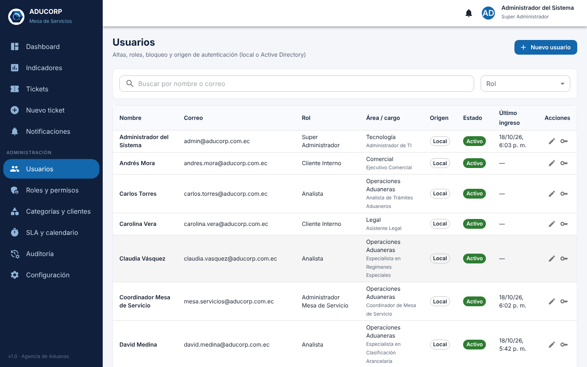
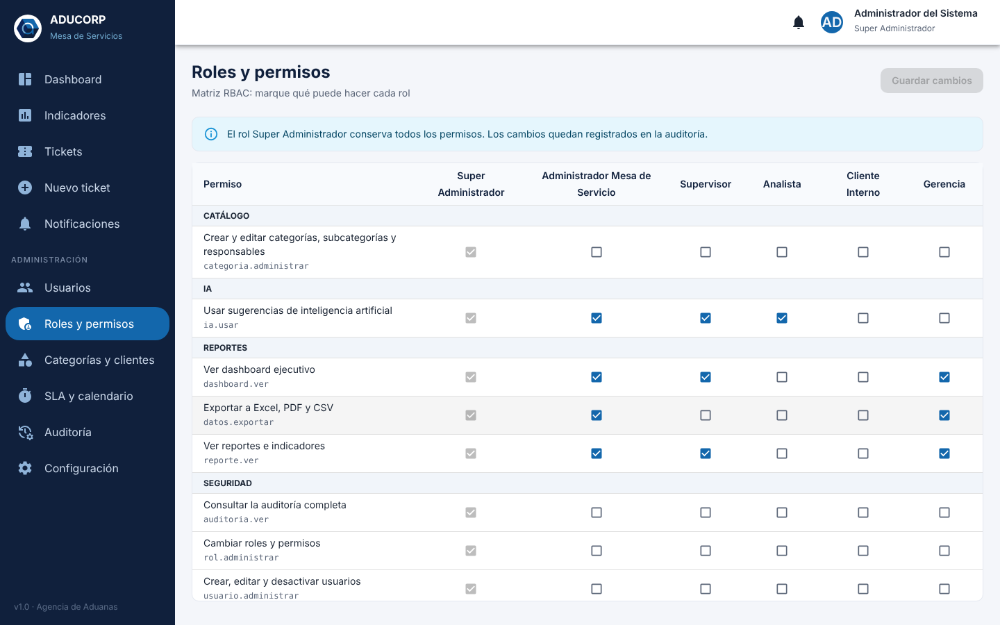
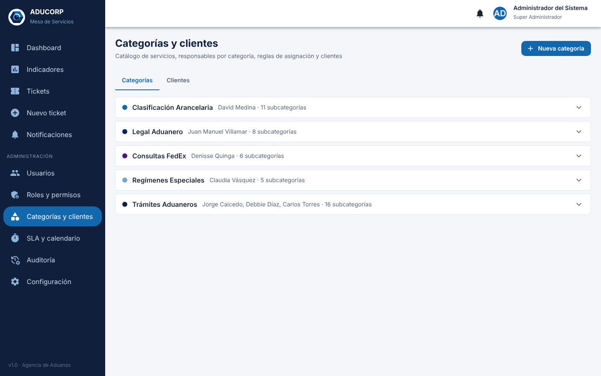
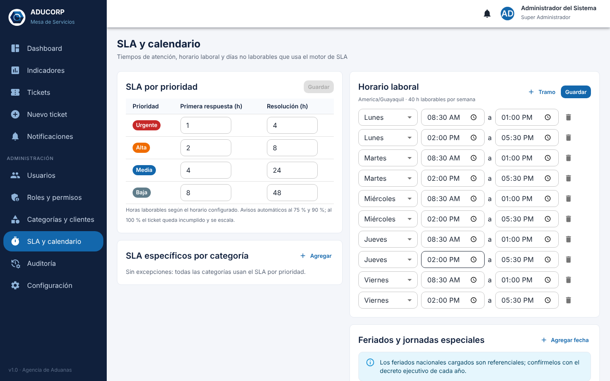
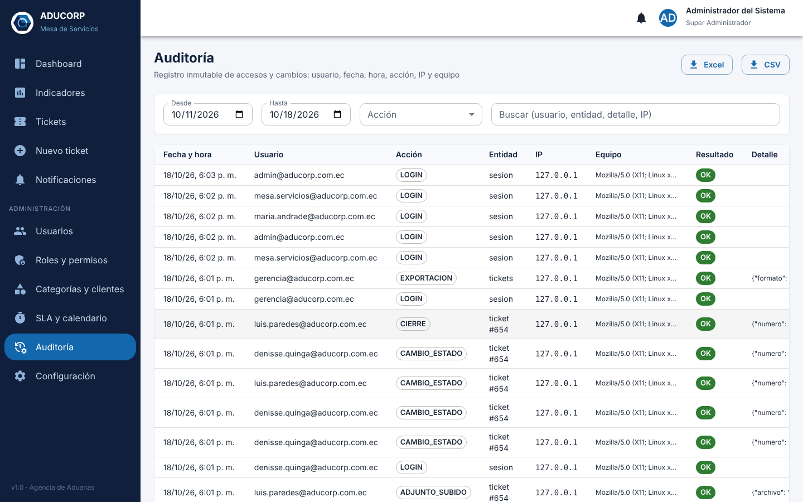

# Manual del administrador

Este manual es para quienes administran la Mesa de Servicios desde la propia aplicación: el **Super Administrador** (TI) y el **Administrador de Mesa** (coordinación). Todo lo que se describe está en el menú **Administración**. Cada opción aparece solo si el rol tiene el permiso correspondiente. La instalación y las tareas del servidor están en el [manual técnico](07-manual-tecnico.md).

| Pantalla | Super Admin | Admin Mesa |
|---|:-:|:-:|
| Usuarios | ✔ | |
| Roles y permisos | ✔ | |
| Categorías y clientes | ✔ | |
| SLA y calendario | ✔ | ✔ |
| Auditoría | ✔ | |
| Configuración | ✔ | |

## 1. Primeros pasos después de la instalación

1. Ingrese con `admin@aducorp.com.ec` y la contraseña inicial `Aducorp2026!`. El sistema le pedirá cambiarla.
2. Revise **Configuración**: nombre de la empresa, umbrales de aviso y límites de adjuntos (sección 7).
3. Revise **SLA y calendario**: horario laboral y feriados del año (sección 5).
4. Cree o active a los usuarios reales y asígneles su rol (sección 2). Si se usa Active Directory, los usuarios se crean solos en su primer ingreso.
5. Revise **Categorías y clientes**: responsables de cada categoría, supervisor y clientes VIP (sección 4).

## 2. Usuarios

La lista muestra el nombre, el correo, el rol, el área y el cargo, el origen (local o Active Directory), el estado (Activo, Bloqueado o Inactivo) y el último ingreso. Puede filtrar por rol y buscar por nombre o correo.

Cuando el login es con Microsoft 365, los usuarios aparecen con origen **Microsoft 365** y su rol lo decide el grupo de Entra ID al que pertenecen: cámbielo en Entra ID, no aquí. Vea [10-microsoft-365.md](10-microsoft-365.md).

**Crear un usuario:** botón **Nuevo usuario**.

* **Autenticación local:** si deja vacía la *contraseña inicial*, el sistema genera una contraseña temporal y la muestra una sola vez con el botón **Copiar**. Entréguela al usuario por un canal seguro; en su primer ingreso deberá cambiarla.
* **Active Directory:** indique el *usuario de dominio* (por ejemplo `dmedina`). No se guarda ninguna contraseña, porque se valida contra el dominio.
* **Supervisor directo y área:** se usan en los reportes y en los avisos de escalamiento.

**Acciones habituales:**

| Necesidad | Cómo |
|---|---|
| Cambiar el rol o los datos | Botón **Editar** (lápiz). Nadie puede cambiar su propio rol |
| Olvidó la contraseña o la cuenta está bloqueada | **Generar contraseña temporal** (llave): desbloquea la cuenta y obliga a cambiar la clave |
| Alguien deja la empresa | **Editar** › desmarque **Activo**. Su historial y auditoría se conservan; no se recomienda eliminar usuarios |
| Cortar una sesión abierta de inmediato | Desactive al usuario: el sistema lo comprueba en cada petición y el acceso se corta al instante |

La cuenta se bloquea 15 minutos tras 5 intentos fallidos (ambos valores se configuran en la sección 7).

## 3. Roles y permisos (matriz RBAC)

Hay 6 roles: Super Administrador, Administrador de Mesa, Supervisor, Analista, Cliente interno y Gerencia. La matriz muestra cada permiso en una fila y cada rol en una columna; marque o desmarque y guarde.

* Los permisos del **Super Administrador** no se pueden reducir, para que nunca se pierda el acceso de administración.
* Además del permiso, el sistema aplica un **alcance de datos** que no depende de la matriz: el Analista ve los tickets que tiene asignados, el Supervisor los de las categorías que supervisa y el Cliente interno los que él mismo creó.
* Todo cambio queda en la auditoría con la lista de permisos antes y después.

La matriz inicial está en [01-arquitectura.md §9](01-arquitectura.md#9-matriz-rbac).

## 4. Categorías, subcategorías y clientes

**Categorías.** Cada categoría tiene:

* **Código, nombre, descripción, color y orden.** El color y el orden se usan en las listas y los gráficos.
* **Supervisor:** recibe el aviso del 90 % del SLA y ve todos los tickets de la categoría.
* **Responsables:** analistas que atienden la categoría. Uno se marca como principal.
* **Modo de asignación:**

| Modo | Comportamiento al crear un ticket |
|---|---|
| Responsable principal | Se asigna al responsable principal |
| Balanceo por carga | Se asigna al responsable con menos tickets abiertos (por ejemplo, Trámites Aduaneros) |
| Manual (la mesa asigna) | Queda en *Nuevo* hasta que la mesa o el supervisor lo asigne |

* **Palabras clave (IA):** términos separados por comas que ayudan a clasificar automáticamente los tickets nuevos.

**Subcategorías.** Cada subcategoría tiene sus propias **palabras clave** y una **plantilla de respuesta sugerida**, que la IA propone al analista como primer borrador.

**Clientes.** Cada cliente tiene RUC, razón social, correo, teléfono y la marca **VIP**. Los tickets de clientes VIP reciben una prioridad sugerida más alta.

Una categoría o subcategoría con tickets no se elimina: se marca **Inactiva**, deja de ofrecerse en los tickets nuevos y su historial se conserva.

## 5. SLA y calendario

**SLA por prioridad.** Define las horas laborables de primera respuesta y de resolución:

| Prioridad | Primera respuesta | Resolución |
|---|---|---|
| Urgente | 1 h | 4 h |
| Alta | 2 h | 8 h |
| Media | 4 h | 24 h |
| Baja | 8 h | 48 h |

**SLA por categoría.** Reemplaza el anterior para una combinación de categoría y prioridad. Por ejemplo, Legal Aduanero con prioridad Alta y 16 h de resolución.

**Horario laboral.** Tramos por día de la semana (por defecto, lunes a viernes de 08:30 a 13:00 y de 14:00 a 17:30). Solo se cuentan esas horas.

**Feriados y jornadas especiales.**

* *Feriado (no laborable):* el día no cuenta para el SLA.
* *Jornada especial (horario reducido):* el día cuenta solo en el horario indicado, por ejemplo el 24 de diciembre de 08:30 a 13:00.

Cargue al inicio de cada año los feriados nacionales que decrete el Gobierno, incluidos los traslados. La lista inicial es de referencia.

Los cambios de SLA se aplican a los **tickets nuevos**. Los tickets abiertos conservan los plazos con los que se crearon, salvo que se registre una excepción.

**Excepciones por ticket.** Desde el detalle de un ticket abierto, en *Más acciones › Excepción de SLA*, quien tenga el permiso de modificar SLA (Super Admin y Admin Mesa) puede:

* conceder una **extensión** de minutos laborables, por ejemplo cuando el SENAE tiene caído el sistema ECUAPASS;
* **excluir** el ticket del indicador de cumplimiento.

Ambas piden un motivo y quedan registradas con el nombre de quien las aprobó.

**Escalamiento automático.** El worker revisa los tickets cada minuto:

| Consumo del SLA | Acción |
|---|---|
| 75 % | Aviso al responsable |
| 90 % | Aviso al supervisor de la categoría y al coordinador de la mesa |
| 100 % | Marca *Incumplido*, pasa a *Escalado* y avisa al supervisor y al coordinador |

## 6. Auditoría

Registra cada inicio de sesión (incluidos los fallidos), creación, cambio, asignación, exportación, descarga de adjuntos y cambio de configuración. Cada registro tiene fecha y hora, usuario, acción, entidad, IP, equipo y resultado. Puede filtrar por fechas y acción y buscar por usuario, entidad, detalle o IP.

Los registros **no se pueden modificar ni borrar**, ni siquiera desde la base de datos, porque un trigger lo impide. Use la auditoría para:

* investigar quién cambió un ticket o un SLA;
* revisar intentos de acceso fallidos o adjuntos rechazados (resultado *ERROR*);
* responder a una auditoría interna o externa.

## 7. Configuración

| Parámetro | Valor inicial | Efecto |
|---|---|---|
| `empresa.nombre` | ADUCORP Asesores Aduaneros y Logísticos Cía. Ltda. | Nombre en los correos y reportes |
| `sla.umbral_aviso_1` | 75 | % del SLA para el aviso al responsable |
| `sla.umbral_aviso_2` | 90 | % del SLA para el aviso al supervisor |
| `ticket.cierre_automatico_h` | 72 | Horas laborables en *Resuelto* antes del cierre automático (0 lo desactiva) |
| `adjuntos.max_mb` | 20 | Tamaño máximo por archivo |
| `adjuntos.extensiones` | pdf, doc, docx, xls, xlsx, csv, jpg, jpeg, png, txt, xml, zip, msg, eml | Extensiones permitidas |
| `seguridad.max_intentos` | 5 | Intentos fallidos antes de bloquear la cuenta |
| `seguridad.bloqueo_min` | 15 | Minutos de bloqueo |

Además de la extensión, el sistema comprueba el contenido real de cada archivo y rechaza los ejecutables aunque se les cambie el nombre.

## 8. Reportes y exportaciones

Los administradores y la Gerencia ven el **Dashboard** y los **Reportes** (por categoría, responsable, cliente e histórico) y pueden exportar a Excel, PDF y CSV. Cada exportación queda en la auditoría. El uso de los reportes se explica en el [manual de usuario](09-manual-usuario.md#6-dashboard-y-reportes).

## 9. Buenas prácticas

* Mantenga al menos **dos** Super Administradores activos y no use la cuenta `admin` para el trabajo diario.
* Revise la auditoría cada semana y los usuarios activos cada mes; desactive a quienes ya no trabajan en la empresa.
* Antes de cambiar un SLA, revise el informe de cumplimiento del último trimestre para fijar metas alcanzables.
* Al crear una categoría, defina siempre un supervisor y al menos un responsable, para que ningún ticket quede sin atender.
