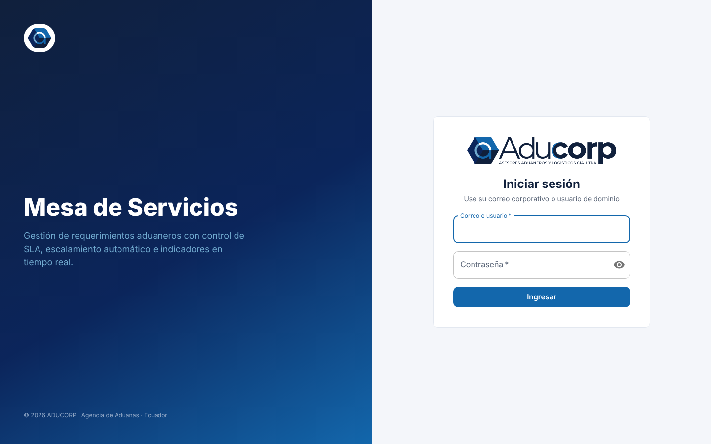
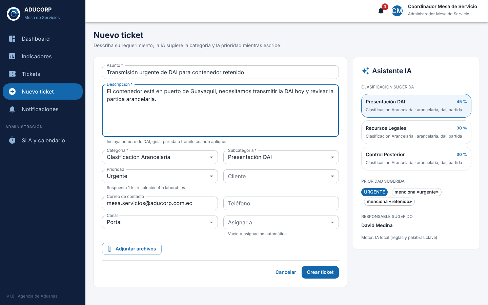
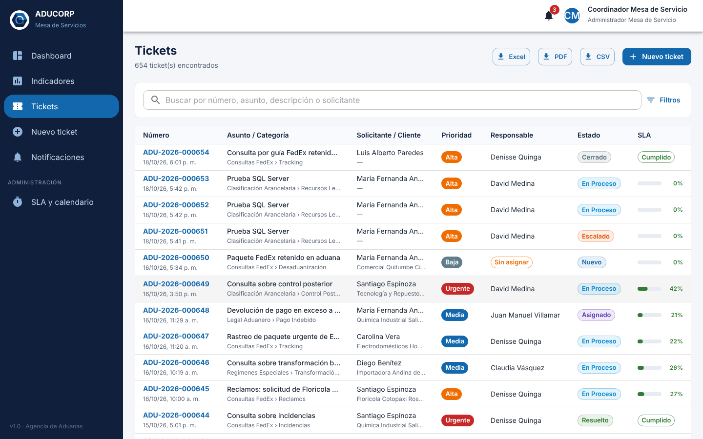
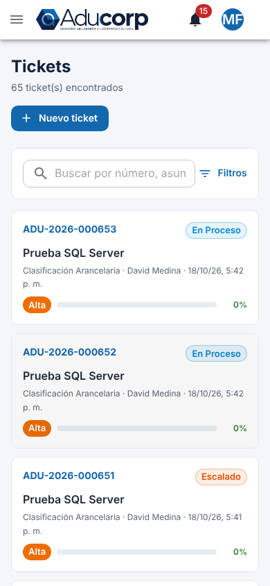
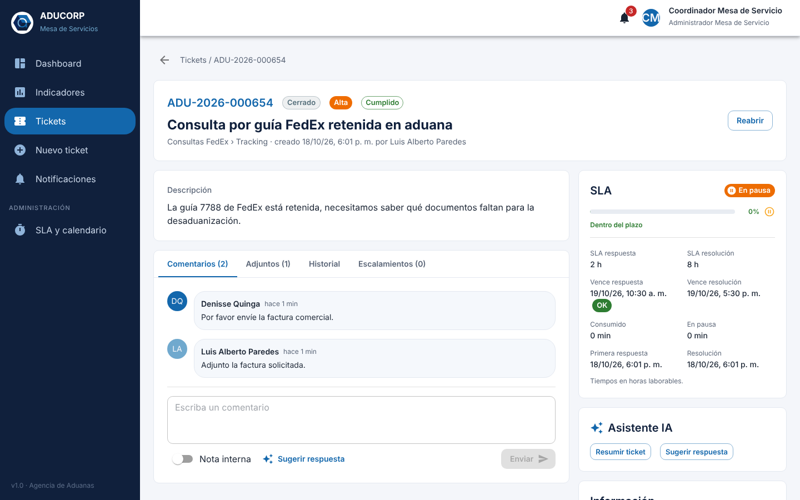
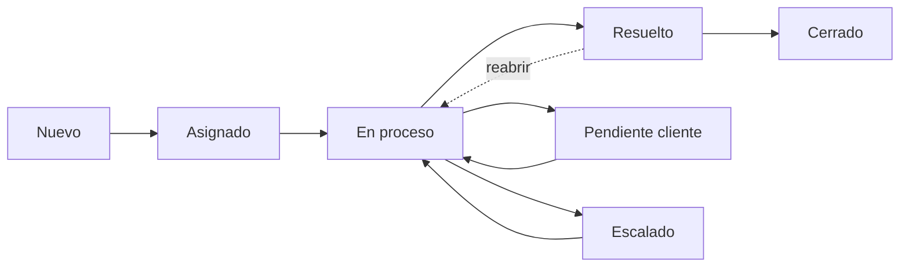
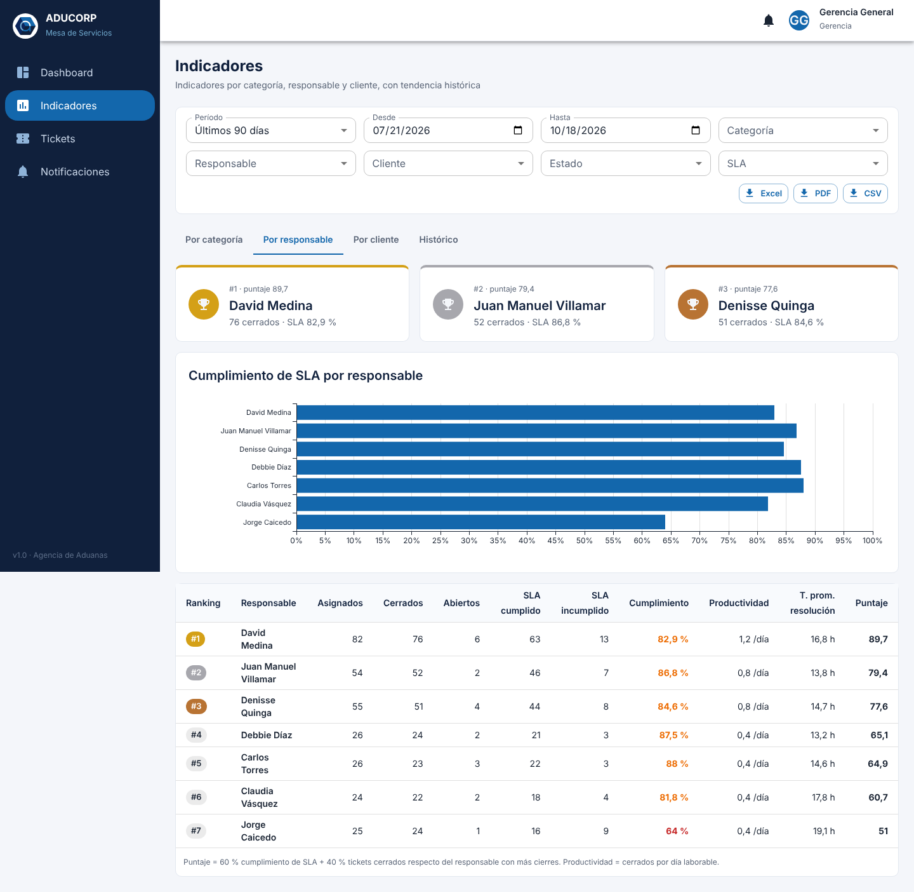
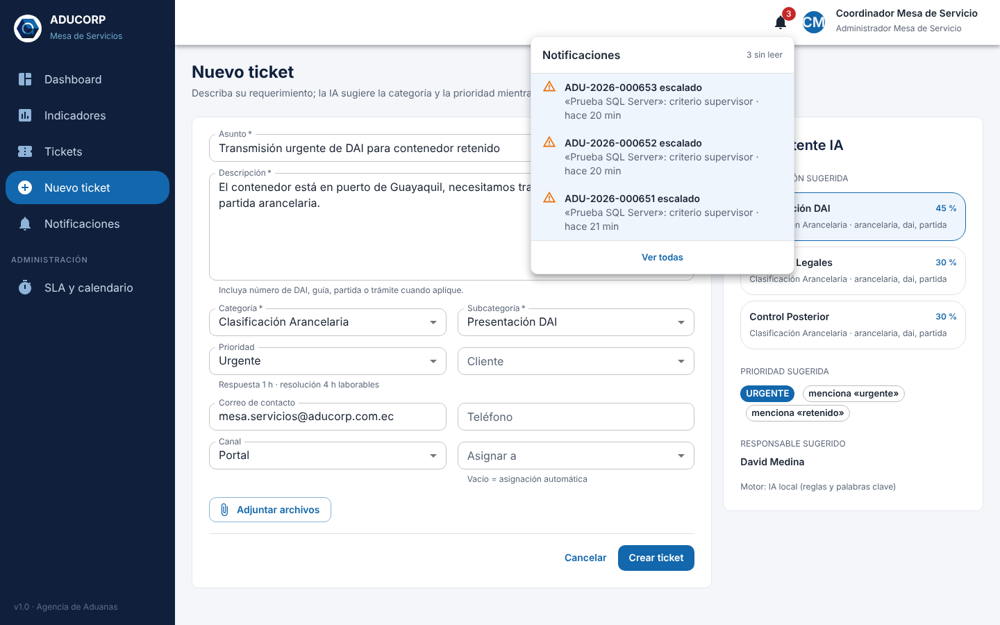

# Manual de usuario

La Mesa de Servicios de ADUCORP es el canal único para pedir y atender consultas de clasificación arancelaria, legal aduanero, FedEx, regímenes especiales y trámites aduaneros. Este manual explica cómo usarla según su rol. Lo que ve en pantalla depende de los permisos de su rol.

| Rol | Qué hace en la mesa |
|---|---|
| **Cliente interno** | Crea tickets, sigue su avance, responde cuando le piden información y reabre si la solución no le sirve |
| **Analista** | Atiende los tickets que tiene asignados dentro del plazo (SLA) |
| **Supervisor** | Vigila los tickets de sus categorías, reasigna, escala y revisa los indicadores de su área |
| **Admin Mesa** | Coordina toda la mesa: asigna, controla los SLA y revisa los indicadores |
| **Gerencia** | Consulta el dashboard, los indicadores y las exportaciones (solo lectura) |
| **Super Admin** | Administra el sistema (ver el [manual del administrador](08-manual-administrador.md)) |

## 1. Ingreso

1. Abra la dirección que le indicó TI, por ejemplo `https://mesa.aducorp.com.ec`.
2. Escriba su correo y su contraseña. Si la empresa usa Active Directory, son los mismos de su computadora.
3. La primera vez, o después de que TI le asigne una contraseña temporal, el sistema le pedirá una nueva. Debe tener al menos 10 caracteres, con mayúscula, minúscula, número y símbolo.

Tras 5 intentos fallidos la cuenta se bloquea 15 minutos. Si olvidó su contraseña, pida a TI una contraseña temporal.

La sesión se renueva sola mientras trabaja. Al terminar, use **Cerrar sesión** en el menú de su nombre, sobre todo en equipos compartidos.

## 2. Crear un ticket

1. Pulse **Nuevo ticket**.
2. Escriba un **asunto** corto y una **descripción** completa: número de DAI o DAE, cliente, mercancía, plazos y lo que necesita.
3. Mientras escribe, el **Asistente IA** propone la categoría y la subcategoría, con su porcentaje de confianza y las palabras que reconoció, además de la prioridad y el responsable. Si la propuesta es correcta, no tiene que hacer nada; si no, pulse otra sugerencia o elija la categoría a mano.
4. Elija el **cliente** si la consulta es de un cliente de ADUCORP y revise la **prioridad**:

| Prioridad | Cuándo usarla | Plazo de solución |
|---|---|---|
| Urgente | Mercancía detenida, aforo en curso, multa o plazo legal que vence hoy | 4 h laborables |
| Alta | Afecta a un embarque o trámite de esta semana | 8 h |
| Media | Consulta normal | 24 h (3 días laborables) |
| Baja | Informativa, sin fecha | 48 h |

5. Adjunte los documentos que ayuden (PDF, Word, Excel, imágenes, XML, ZIP, correos `.msg` o `.eml`, hasta 20 MB cada uno).
6. Pulse **Crear ticket**. Recibirá el número (por ejemplo `ADU-2026-000651`) y el ticket queda asignado de forma automática al responsable de la categoría.

El personal de la mesa ve además los campos **Canal** (portal, correo, teléfono, presencial), para registrar pedidos que llegaron por otra vía, y **Asignar a**, para elegir el responsable. Si deja *Asignar a* vacío, la asignación es automática.

## 3. Lista de tickets

* Cada fila muestra el número, el asunto y la categoría, el solicitante y el cliente, la prioridad, el estado, el responsable y la **barra de SLA** con el porcentaje del plazo consumido.
* La barra es verde por debajo del 75 %, amarilla desde el 75 %, naranja desde el 90 % y roja cuando el plazo venció.
* **Filtros:** estado, prioridad, categoría, subcategoría, responsable, cliente, fechas, SLA (cumplido, incumplido, en curso o en riesgo, es decir 75 % o más) y *Solo asignados a mí*. Pulse **Filtros** para mostrarlos.
* **Orden:** más recientes, más antiguos o mayor consumo de SLA, para atender primero lo que está por vencer.
* Quien tiene permiso de exportar puede descargar la lista filtrada en Excel, PDF o CSV.

En el celular la lista se muestra como tarjetas:

## 4. Atender un ticket (Analista, Supervisor y Admin Mesa)

El detalle muestra la descripción, los datos del solicitante y del cliente, los plazos de **primera respuesta** y **resolución**, la conversación y el **historial** completo.

**Flujo habitual:**

| Acción | Botón | Efecto |
|---|---|---|
| Empezar a trabajar | **Iniciar atención** | Pasa a *En proceso* y cumple la primera respuesta |
| Pedir información al solicitante | **Cambiar estado** › *Pendiente cliente* | **Pausa el SLA** hasta que el solicitante responda |
| Responder o registrar avance | Caja de comentario | Un comentario público también cumple la primera respuesta |
| Dejar una nota solo para el equipo | Marque **Nota interna** | El solicitante no la ve |
| Adjuntar un documento | **Adjuntar archivo** | Queda en el ticket y en el historial |
| Dar la solución | **Resolver** | Detiene el SLA de resolución |
| Pedir ayuda a su supervisor | **Más acciones › Escalar** | Pasa a *Escalado* con el motivo y avisa al supervisor |
| Cambiar asunto, categoría o prioridad | **Más acciones › Editar** | Si cambia la prioridad, el plazo se recalcula |
| Reasignar (Supervisor y Admin Mesa) | **Reasignar** | Avisa al nuevo responsable |

El ticket resuelto se **cierra solo** después de 72 horas laborables. También puede cerrarse antes desde *Más acciones › Cerrar directamente*.

**Asistente IA en el ticket:**

* **Sugerir respuesta:** propone un borrador a partir de la plantilla de la subcategoría. Revíselo y edítelo antes de enviarlo.
* **Resumir ticket:** resume la conversación, útil en tickets largos o al recibir uno reasignado.
* **Riesgo de incumplimiento:** porcentaje de probabilidad de que el ticket no se cumpla a tiempo (verde por debajo de 40 %, ámbar desde 40 % y rojo desde 70 %), según el plazo consumido, el estado y la carga del responsable.

**Avisos de SLA.** Al 75 % del plazo recibe una notificación y un correo. Al 90 % se avisa a su supervisor y al coordinador. Al 100 % el ticket queda *Incumplido* y se escala solo.

## 5. Seguimiento del solicitante (Cliente interno)

* En **Tickets** ve todos los que creó, con su estado y su avance.
* Cuando un ticket está en **Pendiente cliente**, la mesa espera su respuesta: escríbala en el comentario y adjunte lo que le pidieron. El plazo se reanuda.
* Si la solución no resolvió el problema, use **Reabrir** en un ticket *Resuelto* o *Cerrado* e indique el motivo.
* No ve las notas internas del equipo.

## 6. Dashboard y reportes

El **Dashboard** (Gerencia, Admin Mesa y Supervisores, estos últimos solo con su área) muestra:

* tickets totales, abiertos, cerrados, escalados y vencidos;
* % de cumplimiento del SLA y tiempos promedio de respuesta y resolución, en horas laborables;
* la tendencia por día, semana o mes, y el cumplimiento del SLA por período;
* las categorías y los responsables con más tickets;
* los **tickets en riesgo**: abiertos que pasaron el 75 % del plazo.

Pulse un indicador o una fila para abrir la lista de tickets correspondiente.

En **Indicadores** encontrará los reportes por categoría, por responsable (con ranking), por cliente y el histórico mensual:

**Filtros de período:** últimos 7, 30 o 90 días, 6 meses, el último año o un rango de fechas, más categoría, responsable, cliente, estado y SLA. Los botones **Excel**, **PDF** y **CSV** descargan el reporte con los filtros aplicados.

## 7. Notificaciones

La campana de la barra superior muestra cuántas notificaciones tiene sin leer: tickets asignados, comentarios, pedidos de información, escalamientos, resoluciones, cierres, reaperturas y avisos de SLA. En **Notificaciones** puede ver solo las no leídas y abrir el ticket con un clic. Las más importantes también le llegan por correo.

## 8. Preguntas frecuentes

**¿Por qué el plazo no avanza de noche ni el fin de semana?** El SLA cuenta solo horas laborables: de lunes a viernes, de 08:30 a 13:00 y de 14:00 a 17:30, sin feriados.

**El ECUAPASS no funciona y no puedo cumplir el plazo. ¿Qué hago?** Registre lo ocurrido en una nota y pida al coordinador de la mesa una **excepción de SLA**, que puede extender el plazo o excluir el ticket del indicador.

**¿Puedo borrar un comentario o un adjunto?** No. Todo lo que se registra en un ticket queda en el historial para auditoría. Si se equivocó, agregue un comentario aclarándolo.

**No me deja subir un archivo.** Revise que la extensión esté permitida y que no supere 20 MB. El sistema también rechaza los archivos cuyo contenido no coincide con su extensión, como un ejecutable renombrado a `.pdf`.
